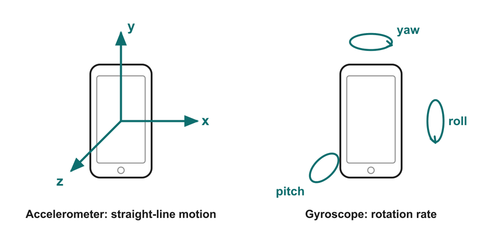

# 01 · Rotation basics: what a gyroscope actually measures

> **Read this first if the word "gyroscope" means nothing to you yet.**
> After this page you should be able to say, in one sentence, what a gyro measures and how it differs from an accelerometer.

---

## 1. Two kinds of motion

Anything that moves can do two separate things:

1. **Translate**: slide from one place to another (a car driving down a straight road).
2. **Rotate**: turn about an axis (the same car going round a roundabout, or a phone you flip from portrait to landscape).

Most real motion is a mix of both. A cricket ball bowled by a spinner *travels* towards the batter (translation) and *spins* as it goes (rotation). Engineers measure these two things with two different sensors.

| Motion | Everyday example | Sensor that measures it |
| --- | --- | --- |
| Translation (speeding up, slowing down, gravity) | Auto-rickshaw braking hard | **Accelerometer** |
| Rotation (how fast you are turning) | Auto-rickshaw swinging round a corner | **Gyroscope** |

## 2. Angle vs. angular rate

- **Angle** tells you *how far* something has turned: "the phone is rotated 90°".
- **Angular rate** (also called **angular velocity** or **rotation rate**) tells you *how fast* it is turning: "the phone is turning at 180 degrees per second".

Think of distance vs. speed. Angle is like distance; angular rate is like speed.

> **A gyroscope measures angular rate, not angle.** To get the angle you must add up (integrate) the rate over time. Keep this in mind: it is the root of the "drift" problem in [doc 12](12_performance_challenges.md).

### Units

| Unit | Meaning | Where you will see it |
| --- | --- | --- |
| **°/s** (degrees per second) | Degrees turned each second | Datasheets, phone apps, the deck |
| **rad/s** (radians per second) | Radians turned each second | Physics equations (the Coriolis formula) |
| **°/h** (degrees per hour) | Very slow rates | Gyro drift and bias stability (slides 17, 21) |

Conversion: one full turn = 360° = 2π rad, so **1 rad ≈ 57.3°** and **1 rad/s ≈ 57.3 °/s**.

**Worked example 1: flipping a phone.** You rotate your phone from portrait to landscape (90°) in half a second.

- Angular rate = 90° / 0.5 s = **180 °/s**
- In rad/s: 180 / 57.3 ≈ **3.14 rad/s** (that is π rad/s, since 180° = π rad)

**Worked example 2: an auto-rickshaw at a corner.** It turns through 90° in 3 s.

- Angular rate = 90° / 3 s = **30 °/s ≈ 0.52 rad/s**

**Worked example 3: the Earth itself.** The Earth turns 360° in about 24 hours.

- 360° / 24 h = **15 °/h**, which is only about **0.004 °/s**.
- This tiny number matters later: a consumer MEMS gyro's slow drift (around 10 °/h, slide 21) is about as big as the Earth's own rotation, so a phone gyro cannot "feel" the Earth turning.

For scale: a typical phone-type gyro chip can be set to full-scale ranges from ±250 °/s up to ±2000 °/s (for example the InvenSense MPU-6050, whose die is on the title slide) [S1].

## 3. The three axes: roll, pitch, yaw

*Diagram from the deck (slide 3). Left: the three straight-line axes an accelerometer uses. Right: the three rotations a gyroscope measures.*

Any rotation can be broken into turns about three perpendicular axes. Aircraft and car engineers name them:

| Name | Rotation about… | Car / aeroplane picture | Phone picture |
| --- | --- | --- | --- |
| **Roll** | the front-to-back axis | Plane dips one wing; car leans in a sharp turn | Tilting the phone left/right like a steering wheel |
| **Pitch** | the side-to-side axis | Plane nose goes up or down; car "nose-dives" when braking | Tipping the top of the phone towards or away from you |
| **Yaw** | the vertical axis | Plane or car turns left/right on the road | Spinning the phone flat on the table like a fidget spinner |

A **3-axis gyroscope** has three sensing elements (or one element that senses all three), one for each axis, so it reports three numbers: ω_x, ω_y, ω_z, each in °/s.

The exact mapping of roll/pitch/yaw to the chip's x/y/z depends on how the chip is mounted, so don't worry if two books label them differently.

## 4. What a gyroscope measures, in one sentence

> **A gyroscope measures how fast the object it is attached to is rotating, about each of its axes, in degrees per second.**

It does *not* measure:
- which way is down (that is the accelerometer's job),
- which way is north (that is a magnetometer's job),
- the absolute angle directly (you get that only by integrating the rate).

## 5. Accelerometer vs. gyroscope: the "phone on a table" test

Put a phone flat on a table and read its sensors (you can do this with any free "sensor test" app). You will see:

| Sensor | Reading | Why |
| --- | --- | --- |
| Accelerometer | **≈ 1 g** (≈ 9.81 m/s²), pointing up | It feels gravity |
| Gyroscope | **≈ 0 °/s** on all three axes | Nothing is rotating |

### Why does the accelerometer read 1 g when the phone is *not moving*?

This surprises everyone. An accelerometer is basically a tiny mass on a spring. It measures the force needed to hold that mass in place relative to the chip.

- On the table, the table pushes the phone up with a force equal to its weight. Inside the chip, the spring has to push the tiny mass up the same way, so the spring is stretched as if the chip were accelerating **upwards at 1 g**.
- In free fall (drop the phone, carefully, onto a pillow), nothing holds the mass up; the mass and chip fall together and the accelerometer reads **about 0**.

So an accelerometer measures **acceleration plus the effect of gravity** (physicists call this "specific force"). That is why the deck's table on slide 3 says "linear acceleration (incl. gravity)". It is also why an accelerometer can tell which way is down, a fact we use in sensor fusion ([doc 13](13_sensor_fusion_future.md)).

### Why does the gyroscope read 0?

Gravity does not rotate anything. A gyro only responds to *turning*. A phone lying still is not turning (apart from the Earth's 15 °/h, which is too small for a phone gyro to notice), so the reading is zero, plus a little noise and a small offset called **bias** ([doc 12](12_performance_challenges.md)).

### The deck's comparison table, explained

| | Accelerometer | Gyroscope |
| --- | --- | --- |
| Measures | Linear acceleration (incl. gravity) | Angular rate: how fast it turns |
| Unit | m/s² or g | °/s |
| Physics | Force on a proof mass, F = m·a | Coriolis force on a vibrating mass ([doc 04](04_coriolis_effect.md)) |
| Weak spot | Noisy while the device moves (shakes and vibrations look like tilt) | Drifts slowly over time (small errors pile up when you integrate) |

The two weak spots are **different**, which is exactly why combining the two sensors works so well (slide 22).

---

## Key points to remember

- Translation is measured by an **accelerometer**; rotation rate by a **gyroscope**.
- A gyro outputs **angular rate** (°/s or rad/s), not angle. 1 rad/s ≈ 57.3 °/s.
- The three rotation axes are **roll, pitch, yaw**; a 3-axis gyro reports one rate for each.
- Phone at rest: accelerometer ≈ **1 g** (it feels gravity), gyro ≈ **0 °/s** (nothing turns).
- Accelerometer is noisy when moving; gyro drifts over time. Their weaknesses complement each other.

**Which slide uses this:** Slide 3 ("One sensor for linear motion, one for rotation"), and the ideas return on slides 21–22.

## Self-check

1. A drone yaws through 45° in 0.25 s. What is its yaw rate in °/s and rad/s?
2. Why does an accelerometer at rest read 1 g but a gyroscope read 0?
3. A friend says "the gyro tells my phone it is in landscape mode." What is more accurate?
4. Name the rotation when a car turns left at a crossing.

Answers

1. 45° / 0.25 s = **180 °/s** = 180 / 57.3 ≈ **3.14 rad/s**.
2. The accelerometer measures the force needed to hold its proof mass against gravity, which is the same as accelerating upward at 1 g. Gravity does not cause rotation, and the phone is not turning, so the gyro reads about 0 °/s.
3. The **accelerometer** tells which way is down, and that is mainly what decides portrait vs. landscape. The gyro helps by tracking the turning motion quickly and smoothly. Phones usually fuse both.
4. **Yaw** (rotation about the vertical axis).

---

### Sources
- Deck slide 3 and references [1], [3] (Kempe; Yazdi, Ayazi & Najafi).
- [S1] InvenSense, *MPU-6000/MPU-6050 Product Specification* (gyro full-scale range ±250, ±500, ±1000, ±2000 °/s).
- Earth rotation rate: 360° per (approximately) 24 h = 15 °/h. Standard value; see e.g. [Wikipedia: Earth's rotation](https://en.wikipedia.org/wiki/Earth%27s_rotation).
