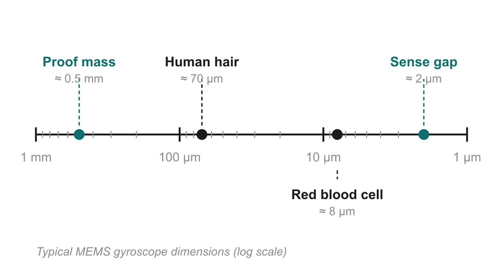
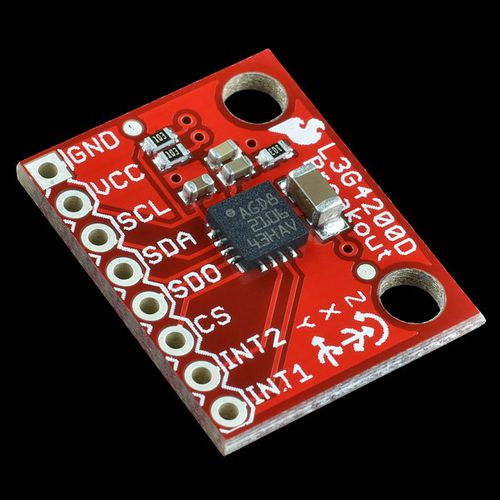
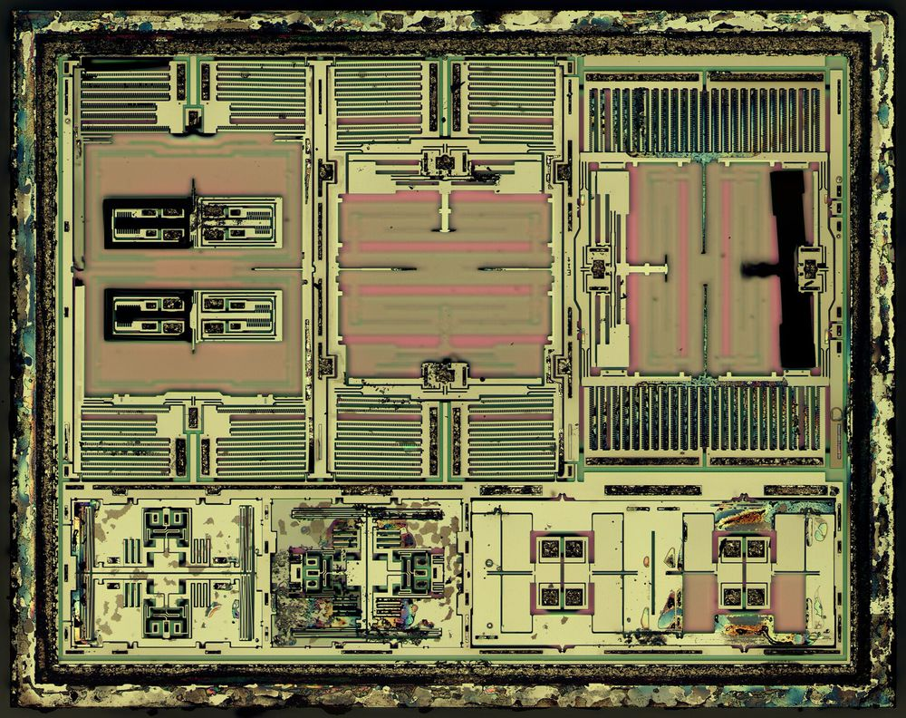

# 02 · What is MEMS?

> After this page you should be able to expand "MEMS", say how small it is, and point to where MEMS parts sit inside a phone.

---

## 1. The name

**MEMS = Micro-Electro-Mechanical Systems.**

Take the words one at a time:

- **Micro**: tiny. Features are measured in **micrometres** (µm). 1 µm = one-thousandth of a millimetre.
- **Electro**: there are electrical parts: electrodes, wires, and usually a chip of electronics right next to it.
- **Mechanical**: there are **real moving parts**: masses that move, springs that bend, comb-shaped fingers that slide past each other.
- **Systems**: all of these work together to do a job (sense rotation, sense pressure, pick up sound…).

An ordinary computer chip has no moving parts; only electrons move. A MEMS chip has actual pieces of silicon that physically move, just far too small to see with the eye.

## 2. How small?

*Diagram from the deck. Note the scale is logarithmic: each big tick is 10× smaller than the last.*

Typical sizes inside a MEMS gyroscope:

| Thing | Size | Comparison |
| --- | --- | --- |
| Proof mass (the moving block) | ≈ 0.5 mm across | About the size of a grain of sand |
| Human hair (for comparison) | ≈ 70 µm thick | |
| Red blood cell (for comparison) | ≈ 8 µm | |
| Sense gap (space between moving mass and fixed electrode) | ≈ 2 µm | About 35× thinner than a hair |
| Features in general (slide 2) | 1–100 µm | "Often thinner than a human hair" |

The whole packaged gyroscope you can buy is a few millimetres on a side. On slide 2, the ST **L3G4200D** 3-axis gyroscope is the 4 × 4 mm black square in the middle of a small red board:

*The whole 3-axis gyroscope is the 4 × 4 mm black package in the centre. Photo: SparkFun Electronics, CC BY 2.0, via Wikimedia Commons.*

And this is what the silicon inside a similar motion sensor looks like under a microscope (title slide):

*The MEMS die of an InvenSense MPU-6050 (gyroscope + accelerometer). The large rectangles are proof masses; the stripy regions are comb electrodes. Photo: ZeptoBars, CC BY 3.0, via Wikimedia Commons.*

## 3. How do you make moving parts that small?

You use the **same tools that make computer chips**: you start with a polished silicon wafer, lay down thin films (**deposition**), print a pattern with light (**lithography**), and carve away material (**etching**). MEMS adds one special trick: you dissolve a hidden layer underneath part of the structure so it becomes **free to move** (**release**). [Doc 09](09_fabrication.md) walks through this step by step.

Two big consequences:

1. **The mechanics and the electronics can share one package.** The moving silicon part and the readout chip are made with compatible processes and sealed together.
2. **Batch fabrication.** Every step happens to a whole wafer at once, so thousands of identical sensors are made together. That makes each one very cheap, which is why every phone can afford several.

## 4. Why is silicon a good material for tiny springs?

Silicon is the material of chips, but it is also a surprisingly good *mechanical* material:

- It is **very elastic**: single-crystal silicon bends and springs back without permanently deforming (it does not get "tired" like a bent paper clip at normal operating stresses).
- It is **light and stiff**, so tiny structures have high resonant frequencies (kilohertz), which suits a vibrating gyro ([doc 05](05_vibrating_gyro_principle.md)).
- The whole chip industry already knows how to shape it precisely.

## 5. MEMS already inside your phone

Slide 2 lists four MEMS devices that most smartphones carry:

| MEMS device | What it does in the phone |
| --- | --- |
| **Accelerometer** | Knows which way is down (screen rotation), counts steps |
| **Gyroscope** | Measures rotation rate (camera stabilisation, games, AR/VR) |
| **Microphone** | MEMS microphones pick up your voice |
| **Pressure sensor (barometer)** | Senses air pressure, which helps estimate altitude / which floor you are on |

In many phones the accelerometer and gyroscope are combined in one package called an **IMU** (Inertial Measurement Unit), for example a 6-axis IMU = 3-axis accelerometer + 3-axis gyroscope.

> Careful wording: many but not all budget phones include a gyroscope. If someone asks, say "most smartphones" rather than "every smartphone".

## 6. Where this fits in the talk

The rest of the deck answers: **how can a speck of silicon sense rotation?** The answer is the Coriolis effect ([doc 04](04_coriolis_effect.md)) acting on a vibrating mass ([doc 05](05_vibrating_gyro_principle.md)), read out by measuring tiny capacitance changes ([doc 06](06_capacitive_sensing.md)).

---

## Key points to remember

- MEMS = **Micro-Electro-Mechanical Systems**: real moving parts plus electronics on a silicon chip.
- Feature sizes are **1–100 µm**; the sense gap in a gyro is about **2 µm**, roughly 35× thinner than a hair.
- They are made with **chip-making tools** (deposit, pattern, etch) plus a **release** step that frees the moving parts.
- **Batch fabrication** of thousands per wafer is what makes them cheap.
- A phone carries several MEMS devices: accelerometer, gyroscope, microphone, pressure sensor.

**Which slide uses this:** Slide 1 (title photo of the MPU-6050 die) and slide 2 ("MEMS: tiny machines built on a silicon chip").

## Self-check

1. What do the four letters of MEMS stand for, and which word separates MEMS from an ordinary chip?
2. Roughly how many sense gaps (≈ 2 µm each) would fit across the thickness of a human hair (≈ 70 µm)?
3. Why does batch fabrication make MEMS gyros cheap?
4. Name three MEMS sensors in a typical phone.

Answers

1. Micro-Electro-**Mechanical** Systems. "Mechanical": MEMS chips have real moving parts.
2. 70 / 2 = **35**.
3. Each process step treats a whole wafer at once, producing thousands of devices in parallel, so the cost of the step is shared among all of them.
4. Any three of: accelerometer, gyroscope, microphone, pressure sensor.

---

### Sources
- Deck slides 1–2; references [1] Kempe and [3] Yazdi, Ayazi & Najafi (MEMS inertial sensors).
- Image credits: MPU-6050 die, ZeptoBars, CC BY 3.0; L3G4200D board, SparkFun Electronics, CC BY 2.0 (both via Wikimedia Commons, as on the deck's References slide). Scale diagram: made by the team for the deck.
