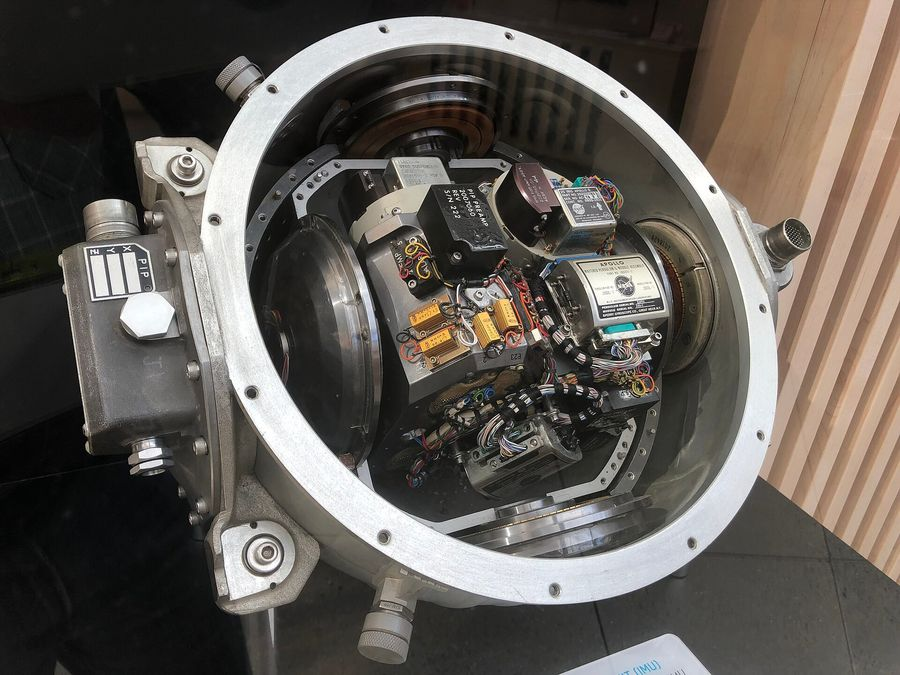

# 03 · History: from spinning wheels to a speck of silicon

> After this page you should be able to tell the story behind slide 4: why a gyroscope used to be the size of a football and is now smaller than a grain of rice.

---

## 1. The original gyroscope: a spinning wheel

Spin a top, or a bicycle wheel held by its axle, and try to tilt it. It resists, and it swings sideways in a strange way. A fast-spinning wheel has a lot of **angular momentum**, and angular momentum likes to keep pointing the same way in space. That is the original gyroscope.

- Early versions were made in the early 1800s (Johann Bohnenberger described one in 1817).
- In **1852 Léon Foucault** used a spinning wheel to show the Earth's rotation and gave the device its name: Greek *gyros* (circle, rotation) + *skopein* (to look at). "A thing to watch rotation." [S1]
- In **1904** Hermann Anschütz-Kaempfe patented the first working **gyrocompass**, and Elmer Sperry followed with his own design; ships could now find north without a magnetic compass. [S1]

### How a spinning-wheel gyro measures rotation

Mount the wheel in a set of rings (**gimbals**) so the vehicle can turn around it freely. The wheel keeps pointing the same way while the vehicle turns, so the angles between the rings tell you the vehicle's orientation. Other designs hold the wheel in place and measure the twisting force needed to make it turn with the vehicle; that force is proportional to the rotation rate.

Problems: you need a motor, precision bearings, and careful balancing. Bearings wear out; the whole thing is heavy, power-hungry and hand-assembled.

## 2. Apollo: the state of the art in the 1960s

*Apollo guidance IMU (1960s), with spinning-wheel gyroscopes on gimbals. Photo: ArnoldReinhold, CC BY-SA 4.0, via Wikimedia Commons.*

This is the photo on slide 4. The Apollo spacecraft navigated to the Moon using an **Inertial Measurement Unit (IMU)**: a stable platform carrying spinning-wheel gyroscopes and accelerometers, hung inside gimbal rings so the platform stayed fixed in space while the spacecraft turned around it.

Things to notice in the photo:
- It is a large, heavy metal assembly (look at the size of the connectors and screws for scale).
- It is full of hand-wired cables and precision mechanical parts.
- Every unit was built and calibrated individually.

## 3. Light instead of wheels (1970s onward)

From the 1970s–80s, **ring laser gyros** and later **fibre-optic gyros** replaced many spinning wheels in aircraft and ships. They have no moving parts at all and use light travelling round a loop (the Sagnac effect). They are very precise but still fairly large and expensive. See [doc 10](10_types_of_gyroscopes.md).

## 4. The vibrating silicon gyro (1990s onward)

The big idea: **don't spin anything; vibrate a tiny mass instead**, and detect the Coriolis force when it rotates ([docs 04](04_coriolis_effect.md)–[05](05_vibrating_gyro_principle.md)).

- The first batch-fabricated silicon micromachined vibratory gyroscope was demonstrated by the **Charles Stark Draper Laboratory in 1991** (Greiff et al.), according to the Yazdi–Ayazi–Najafi review (deck reference [3]). [S2]
- Cars became one of the first large markets (yaw-rate sensing for stability control, [doc 11](11_applications.md)), because there reliability and low cost matter more than extreme precision (see the industrial review, deck reference [4]).
- In **2010** Apple's iPhone 4 shipped with a built-in **3-axis gyro** combined with the accelerometer for "6-axis motion sensing". [S3] After that, gyros spread through smartphones and later into fitness bands, VR headsets and drones.

## 5. Today: a whole IMU on one tiny chip

Slide 4 compares Apollo with a modern chip, the **Bosch BMI270**:

| | Number on slide 4 | What it means |
| --- | --- | --- |
| **Footprint** | 2.5 × 3 mm, 0.8 mm thick | A full **6-axis IMU** (3-axis gyro + 3-axis accelerometer) in a package shorter than a grain of rice [S4] |
| **Efficiency** | 0.7 mA | Current for accelerometer + gyroscope at full data rate (Bosch quotes 685 µA) [S4] |
| **Scalability** | "≈ 1.2 billion" smartphones per year | **Treat as an estimate.** See the warning below. |

> **About the "≈ 1.2 billion" figure.** This is the deck's estimate of yearly smartphone shipments. It has **not been checked** against a named source, so before presenting it, look up a current market-research figure (for example from IDC or Counterpoint) and cite it, or say "over a billion, roughly". Also, the slide says "each with a MEMS gyro"; that is not strictly true, because some budget phones leave the gyro out. Safer: "most of them with a MEMS gyro".

### Why it got so small and cheap: batch fabrication

The real breakthrough is not just size; it is **how** the chips are made. A MEMS gyro is etched into a silicon wafer, and every process step treats the whole wafer at once.

**Illustrative count (assumed numbers):** a 200 mm wafer has an area of π × (100 mm)² ≈ 31,400 mm². If one MEMS die needs about 2 mm × 2 mm = 4 mm², then one wafer holds roughly 31,400 / 4 ≈ **7,800** die sites (fewer after edge losses and test structures). That is what slide 4 means by "thousands of chips per wafer". Compare that with the Apollo IMU, which was built one at a time by hand.

## 6. Timeline at a glance

| Year | Milestone |
| --- | --- |
| 1817 | Bohnenberger's spinning-wheel apparatus |
| 1852 | Foucault names the "gyroscope" |
| 1904 | First working gyrocompass (Anschütz-Kaempfe), Sperry soon after |
| 1960s | Apollo IMU: gimballed spinning-wheel gyros |
| 1970s–80s | Optical gyros (ring laser, then fibre-optic) enter aircraft and navigation |
| 1991 | Draper Lab: first batch-fabricated silicon vibratory gyro |
| 2010 | iPhone 4 ships with a 3-axis gyro |
| Today | 6-axis IMUs of 2.5 × 3 mm drawing under 1 mA |

---

## Key points to remember

- The original gyroscope was a **spinning wheel**; its angular momentum resists changes in direction.
- Apollo's IMU used **spinning-wheel gyros on gimbals**: big, heavy, hand-built.
- Modern MEMS gyros **vibrate** a tiny mass instead of spinning a wheel, so there are no bearings to wear out.
- A full 6-axis IMU today is **2.5 × 3 mm** and draws about **0.7 mA** (Bosch BMI270).
- **Batch fabrication** (thousands per wafer) is what makes billions of cheap gyros possible. The "≈ 1.2 billion" phones figure is an **estimate to double-check**.

**Which slide uses this:** Slide 4 ("The same job, now on a 3 mm chip").

## Self-check

1. What made the old spinning-wheel gyros expensive and short-lived?
2. What does "6-axis IMU" mean?
3. Why should you be careful when quoting "≈ 1.2 billion"?
4. In one sentence, why is a MEMS gyro cheap?

Answers

1. Motors, precision bearings, gimbals and hand assembly. Bearings wear, and each unit had to be built and calibrated by hand.
2. Three axes of accelerometer plus three axes of gyroscope in one package.
3. It is an unverified estimate of yearly smartphone shipments, and not every phone actually contains a gyro. Check a current market source first, or say "over a billion".
4. Because thousands are made at once on each silicon wafer using chip-making tools (batch fabrication), so the cost per chip is tiny.

---

### Sources
- Deck slide 4; reference [10] (Bosch Sensortec BMI270 datasheet).
- [S1] [Wikipedia: Gyroscope](https://en.wikipedia.org/wiki/Gyroscope) (Bohnenberger 1817, Foucault 1852, gyrocompass 1904).
- [S2] N. Yazdi, F. Ayazi, K. Najafi, "Micromachined inertial sensors," *Proc. IEEE* 86(8), 1998 (deck reference [3]); original paper: P. Greiff, B. Boxenhorn, T. King, L. Niles, "Silicon monolithic micromechanical gyroscope," *Transducers '91*, pp. 966–968, 1991.
- [S3] Apple Newsroom, ["Apple Presents iPhone 4"](https://www.apple.com/newsroom/2010/06/07Apple-Presents-iPhone-4/), 7 June 2010 ("built-in 3-axis gyro … 6-axis motion sensing").
- [S4] Bosch Sensortec, BMI270 datasheet / [product flyer](https://mouser.com/pdfdocs/Product_flyer_BMI270.pdf) (2.5 × 3.0 × 0.8 mm; 685 µA at full data rate).
- Image credit: Apollo IMU, ArnoldReinhold, CC BY-SA 4.0, via Wikimedia Commons.
