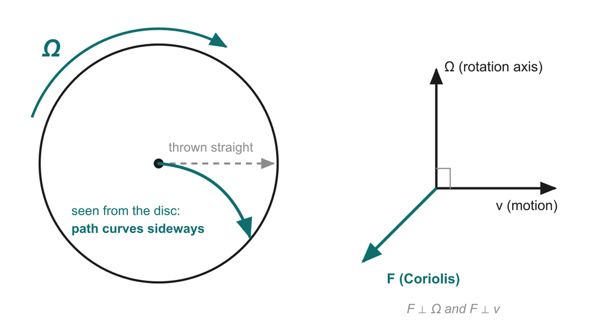

# 04 · The Coriolis effect: rotation pushes a moving mass sideways

> This is the single most important physics idea in the talk. After this page you should be able to explain the merry-go-round picture, read F_c = −2m(Ω × v) term by term, and reproduce the "≈ 2 nN" estimate on slide 5.

---

## 1. Intuition first: the merry-go-round

Imagine you are standing at the centre of a spinning merry-go-round (a *jhoola* at a mela will do) and you roll a ball straight out towards a friend standing at the edge.

- **Seen from the ground** (from above, not spinning): the ball goes in a perfectly **straight line**. No force acts on it sideways.
- **Seen by you, riding the merry-go-round**: while the ball travels outwards, the platform (and your friend) rotate underneath it. By the time the ball reaches the edge, your friend has moved. From your spinning point of view, the ball **curved sideways** and missed.

Nothing actually pushed the ball. But if you insist on describing the motion from the rotating platform, you need a sideways "force" to explain the curve. That apparent force is the **Coriolis force**, named after the French engineer Gaspard-Gustave de Coriolis (1835). [S1]

*Diagram from slide 5. Left: the merry-go-round picture. Right: the three vectors are mutually perpendicular.*

> **Heads-up about this figure.** The arrow on the disc shows a **clockwise** spin, but the ball is drawn curving to the **right** of its direction of travel. For a clockwise-spinning disc the ball should appear to curve to the **left** (to the right is what you'd see for an anticlockwise spin, like the Earth's Northern Hemisphere viewed from above). The idea "it curves sideways" is right; only the drawn direction is flipped. If a sharp listener asks, explain the rule below. The right-hand vector panel is consistent with the equation.

**Key insight for gyros:** the sideways push only happens if two things are true at once:
1. the frame is **rotating** (Ω ≠ 0), and
2. the object is **moving** relative to that frame (v ≠ 0).

The faster the rotation, the bigger the push. **So if we keep a mass moving inside a chip and measure the sideways push, we learn how fast the chip is rotating.** That is the whole idea of a MEMS gyro.

## 2. The equation, term by term

$$\vec F_c = -2m\,(\vec\Omega \times \vec v)$$

| Symbol | Name | Unit | In a MEMS gyro |
| --- | --- | --- | --- |
| **F_c** | Coriolis force (vector) | newton (N) | The sideways push we want to detect |
| **m** | Moving mass | kg | The **proof mass**, about 1 µg = 10⁻⁹ kg |
| **Ω** (capital omega) | Rotation rate of the frame (vector) | rad/s | The chip's rotation rate: **the thing we want to measure** |
| **v** | Velocity of the mass *relative to the rotating frame* | m/s | The drive vibration velocity, about 1 m/s at peak |
| **×** | Cross product | | Gives a vector perpendicular to both Ω and v |
| **2** | A factor that falls out of the maths | | Just remember it |
| **−** | Minus sign | | Sets the direction (see right-hand rule below) |

### What does Ω as a *vector* mean?

A rotation has a rate *and* an axis. We represent it as an arrow pointing **along the axis of rotation**, with length equal to the rate. Its direction is given by the **right-hand grip rule**: curl the fingers of your right hand in the direction of rotation; your thumb points along Ω.

- A phone spinning anticlockwise on a table (seen from above): Ω points **straight up**.
- Spinning clockwise: Ω points **straight down**.

### The cross product in plain words

For two vectors **A** and **B**, the cross product **A × B** is a new vector that:

1. is **perpendicular to both** A and B;
2. has size |A| |B| sin θ, where θ is the angle between them (biggest when they are at 90°, zero when they are parallel);
3. points in the direction given by the **right-hand rule**: point your right-hand fingers along A, curl them towards B; your thumb gives A × B.

Handy unit-vector facts (x, y, z form a right-handed set): **x̂ × ŷ = ẑ, ŷ × ẑ = x̂, ẑ × x̂ = ŷ**, and swapping the order flips the sign (ŷ × x̂ = −ẑ).

### Consequences you should be able to state

- **F ⟂ Ω and F ⟂ v.** The Coriolis force is always sideways to the motion and to the rotation axis. In a gyro this is why the mass is pushed **at 90° to its drive motion**.
- **F ∝ Ω.** Double the rotation rate, double the force. This is what makes the gyro's output proportional to rotation rate ("measure the force and you know the rotation rate", slide 5).
- **F ∝ v.** Keep the mass moving fast to get a bigger signal; that is why we drive it at resonance ([doc 05](05_vibrating_gyro_principle.md)).
- **Reverse Ω → F reverses.** The sign of the output tells the direction of rotation (animation step 6).
- **Reverse v → F reverses.** A vibrating mass's velocity flips every half-cycle, so the Coriolis force also flips every half-cycle; the sense motion is an oscillation, not a steady push ([doc 05](05_vibrating_gyro_principle.md)).
- If v is **parallel** to Ω, sin 0° = 0, so **no** Coriolis force. A gyro element only senses rotation about one axis; you need three elements (or a cleverly designed one) for 3 axes.

### A direction example that matches the deck's animation

Let the chip lie flat in the x–y plane, drive the mass along **x**, and rotate the chip **anticlockwise** about **z** (yaw):

- Ω = Ω ẑ, v = v x̂
- Ω × v = Ωv (ẑ × x̂) = Ωv ŷ
- F_c = −2m Ωv ŷ, i.e. the force points along **−y** when the mass moves in +x.

That is exactly what the animation shows in step 3: drive velocity to the right, Coriolis arrow pointing down, chip turning anticlockwise. Half a cycle later the mass moves in −x and the force points +y.

## 3. Worked example: how big is the force? (slide 5)

Slide 5 uses: m ≈ 1 µg, v ≈ 1 m/s, Ω = 1 rad/s.

**Step 1: convert to SI units.**
- 1 µg = 10⁻⁶ g = 10⁻⁹ kg
- Ω = 1 rad/s ≈ 57 °/s (a brisk turn of the wrist)
- v and Ω are at 90°, so sin 90° = 1

**Step 2: plug in (magnitude).**

|F_c| = 2 m Ω v = 2 × (10⁻⁹ kg) × (1 rad/s) × (1 m/s) = **2 × 10⁻⁹ N = 2 nN**

Units check: kg × (1/s) × (m/s) = kg·m/s² = N. ✓ (radians are dimensionless.)

**Step 3: get a feel for 2 nN.**
- The **weight** of the proof mass itself is mg = 10⁻⁹ kg × 9.81 m/s² ≈ 1 × 10⁻⁸ N ≈ 10 nN. So the Coriolis force at 57 °/s is only about **one-fifth of the mass's own weight**.
- 2 nN is the weight of about 2 × 10⁻⁹ / 9.81 ≈ 2 × 10⁻¹⁰ kg = **0.2 µg**, roughly a grain of dust. That is the deck's "about the weight of a speck of dust".

**Where does v ≈ 1 m/s come from?** The mass vibrates as x(t) = A sin(2πft). Its peak speed is v_peak = 2πfA. With a drive frequency f = 20 kHz and an amplitude A = 8 µm (assumed, typical order of magnitude):
v_peak = 2π × 20,000 s⁻¹ × 8 × 10⁻⁶ m ≈ **1.0 m/s**. A tiny movement, but done 20,000 times a second, gives a respectable speed.

**Smaller rotations give even smaller forces:**
- At 1 °/s (= 0.0175 rad/s): F ≈ 2 × 10⁻⁹ × 0.0175 ≈ **35 pN** (piconewtons).
- At Earth's rotation (7.3 × 10⁻⁵ rad/s): F ≈ **1.5 × 10⁻¹³ N**. This is one reason a phone gyro cannot sense the Earth turning.

### How far does the mass move? ("under a nanometre")

The sense direction is held by a spring of stiffness k. A rough estimate (ignoring any resonant amplification): displacement y ≈ F / k.

For a 1 µg mass whose sense spring gives a sense resonance of about 22 kHz (assumed, slightly above the drive), k = m(2πf)² = 10⁻⁹ × (2π × 22,000)² ≈ **19 N/m**. Then

y ≈ 2 × 10⁻⁹ N / 19 N/m ≈ **1 × 10⁻¹⁰ m = 0.1 nm**,

about the size of a single atom. That matches the deck's "the resulting motion is under a nanometre", and it is why the capacitive sensing stage has to be extraordinarily sensitive ([doc 06](06_capacitive_sensing.md)).

## 4. Where else does the Coriolis effect show up?

- **Weather:** winds flowing towards a low-pressure region get deflected by the Earth's rotation, so cyclones spin anticlockwise in the Northern Hemisphere (Bay of Bengal cyclones) and clockwise in the Southern. [S1]
- **Long-range artillery and missiles** need Coriolis corrections.
- **Myth alert:** the direction your sink or toilet drains is *not* decided by the Coriolis effect; the force is far too weak at that size compared with the shape of the basin and leftover swirl.

---

## Key points to remember

- In a rotating frame, a moving object appears to be pushed **sideways**: the **Coriolis force**, F_c = −2m(Ω × v).
- The force is **perpendicular** to both the rotation axis and the velocity (cross product, right-hand rule).
- The force is **proportional to Ω**, so measuring it measures the rotation rate; reversing Ω reverses the force.
- In a MEMS gyro, m ≈ 1 µg, v ≈ 1 m/s, Ω = 1 rad/s give only **≈ 2 nN**, moving the mass **under a nanometre**.
- To get any force at all the mass must be **moving**, which is why MEMS gyros keep a mass vibrating.

**Which slide uses this:** Slide 5 ("Rotation pushes a moving mass sideways"), and the equation reappears in the animation on slides 7–12.

## Self-check

1. If the proof mass were twice as heavy and vibrated twice as fast, how big would the Coriolis force be at Ω = 1 rad/s?
2. A mass moves along +x and the chip rotates anticlockwise about +z. Which way does the Coriolis force point?
3. Why is there no Coriolis force on a mass that is sitting still inside a rotating chip?
4. Convert 2 nN into the weight of an equivalent mass.

Answers

1. F = 2mΩv, so 2 × 2 = **4 times** bigger: 2 × (2 × 10⁻⁹) × 1 × 2 = **8 nN**.
2. Ω × v = ẑ × x̂ = ŷ, so F = −2m(Ω × v) points along **−y**.
3. Because v = 0 relative to the chip, so Ω × v = 0. That is why the gyro must keep the mass moving (vibrating).
4. m = F / g = 2 × 10⁻⁹ / 9.81 ≈ **2 × 10⁻¹⁰ kg = 0.2 µg**, about a speck of dust.

---

### Sources
- Deck slide 5; references [1] Kempe, [2] Acar & Shkel, [3] Yazdi et al.
- [S1] [Wikipedia: Coriolis force](https://en.wikipedia.org/wiki/Coriolis_force) (history, 1835; deflection to the right in the Northern Hemisphere; weather systems).
- The drive amplitude (8 µm), drive frequency (20 kHz) and sense frequency (22 kHz) above are **assumed illustrative values** within the range on slide 6 (10–30 kHz), chosen to reproduce the deck's numbers. They are not specifications of any particular chip.
