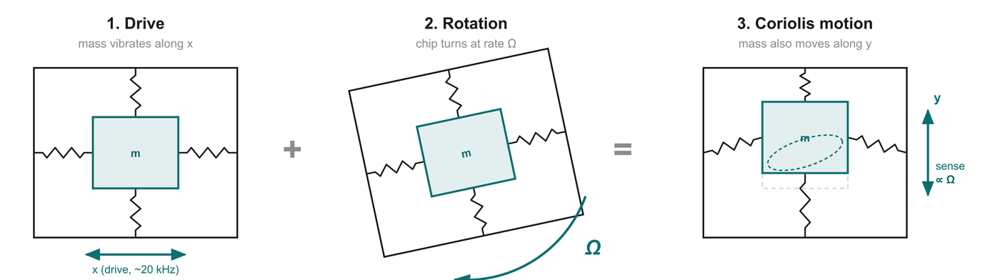
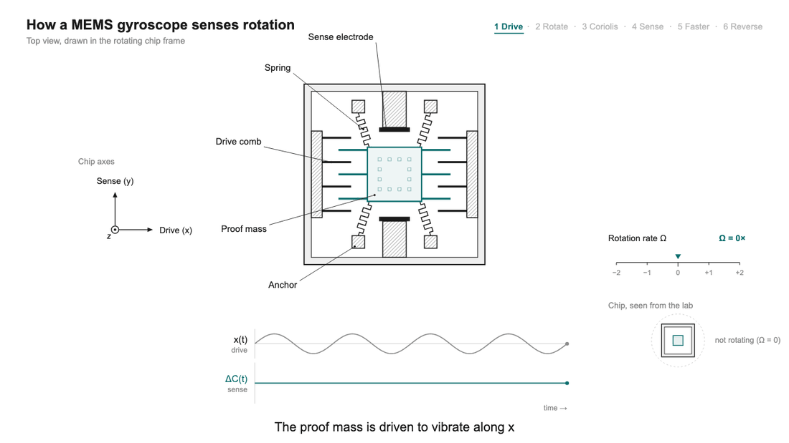
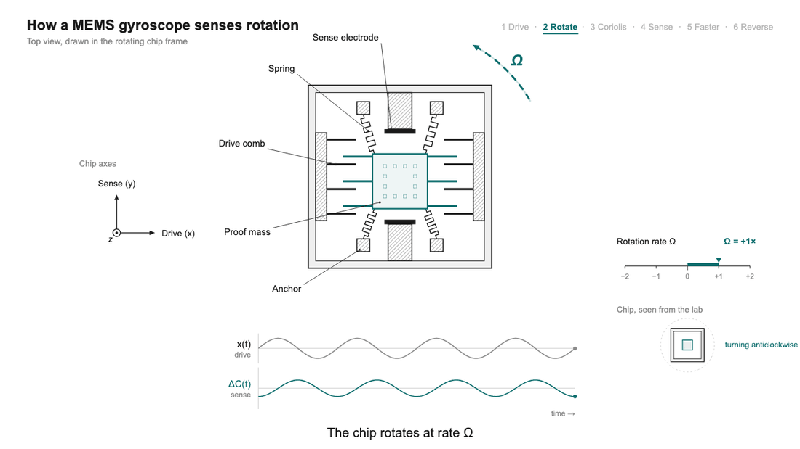
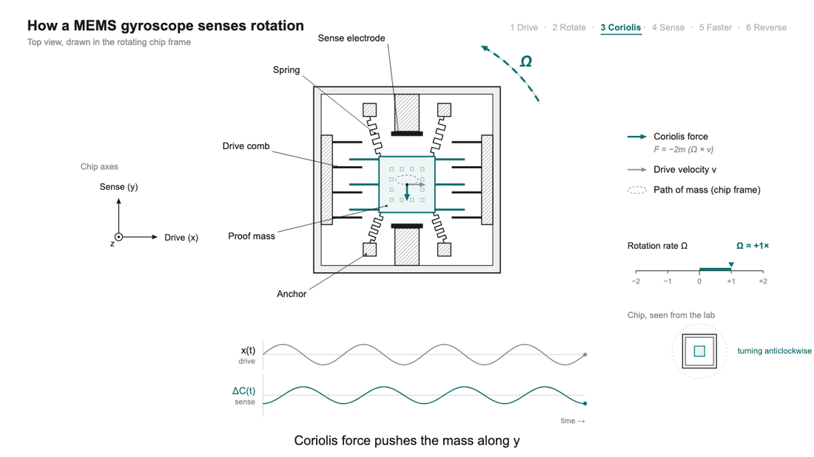
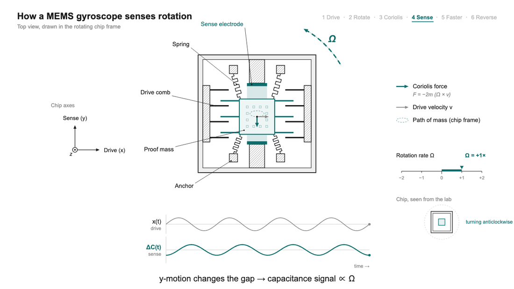
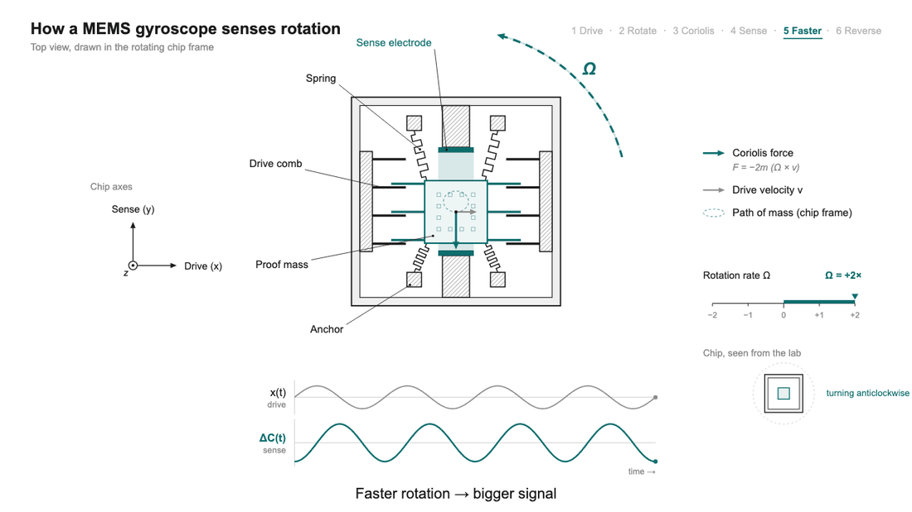
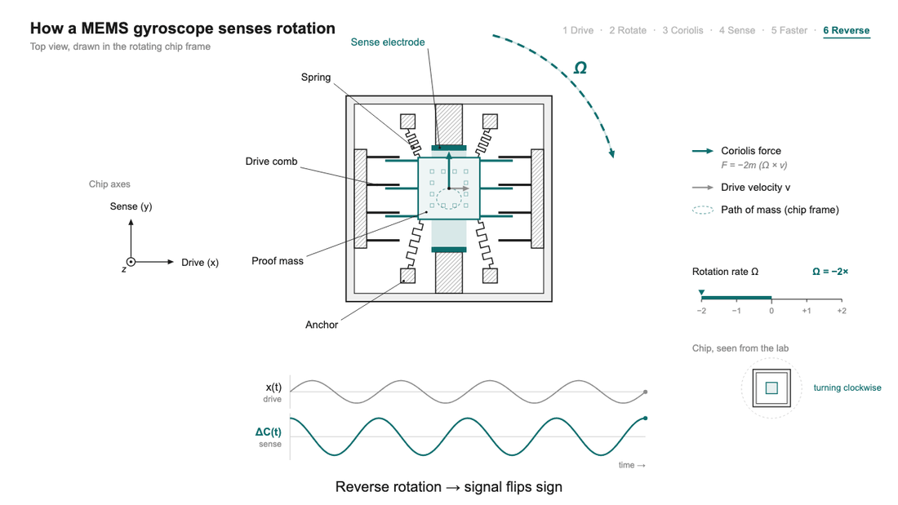

# 05 · The vibrating gyroscope: drive, rotate, sense

> After this page you should be able to explain slide 6 and talk through all six animation steps on slides 7–12 without notes.

---

## 1. The problem: Coriolis needs a moving mass

From [doc 04](04_coriolis_effect.md): the Coriolis force only appears on a mass that is **moving** inside the rotating frame. So the gyro must keep a mass moving all the time.

Two ways to keep something moving inside a small box:

| Option | How | Problem on a chip |
| --- | --- | --- |
| **Spin it** (old gyros) | Motor + rotor on bearings | You cannot easily build bearings and motors in silicon; they would wear, and friction would dominate at this size |
| **Vibrate it** (MEMS gyros) | Mass on springs, pushed back and forth electrically | Easy: springs and electrodes are etched from the same silicon |

A vibrating mass moves back and forth, so its velocity is not constant; but at every instant it *is* moving, and that is all the Coriolis effect needs.

## 2. The two directions: drive and sense

A MEMS gyro element has a **proof mass** held by springs that let it move in **two perpendicular directions** within the chip:

*Diagram from slide 6: Drive + Rotation = Coriolis motion.*

### Drive mode (x direction)

- **Drive combs** (interlocking comb-shaped electrodes) pull the mass left and right using electrostatic force: apply a voltage, opposite charges attract.
- The voltage alternates at the mass–spring system's **resonant frequency**, typically **≈ 10–30 kHz** (slide 6; the diagram uses ~20 kHz).
- **Why resonance?** Like pushing a child on a swing in time with the swing: small pushes at the natural frequency build up a big motion. Driving at resonance gives a large amplitude (micrometres) with only a few volts.
- A **control loop** constantly measures the drive motion and adjusts the push so that the amplitude stays exactly constant. This matters because the Coriolis force is proportional to the drive velocity; if the drive amplitude wandered, the gyro's sensitivity would wander too.

### Sense mode (y direction)

- When the chip **rotates** about the axis perpendicular to x and y (z), the Coriolis force pushes the mass along **y**, at **90°** to the drive.
- The mass also hangs on springs in y, so it moves a tiny amount along y.
- **Sense electrodes** detect this y-motion as a change in capacitance ([doc 06](06_capacitive_sensing.md)).
- **The size of the y-motion is proportional to Ω.** That is the measurement.

### Why exactly 90°?

Because the Coriolis force is a **cross product**: F ∝ Ω × v. With Ω along z and v along x, F must lie along y, perpendicular to both. The direction is not a design choice; it is geometry. The design choice is to put springs and electrodes along that direction so you can catch the motion.

### Why the sense motion oscillates too

The drive velocity v flips sign every half-cycle (left, right, left…). So F = −2m(Ω × v) also flips every half-cycle. The result is a y-oscillation **at the drive frequency**, with an amplitude proportional to Ω. Because the force follows the **velocity** (not the position), the y-motion is shifted by roughly a quarter cycle from the x-motion, so the mass traces a thin **ellipse** (seen in the diagram and in step 3 of the animation). The electronics later turn this oscillating signal back into a steady number using the drive signal as a reference ([doc 06](06_capacitive_sensing.md)).

### "No spinning parts": why it matters

- **No bearings, no wear:** nothing rubs, so it does not wear out.
- **Rugged:** the parts are tiny and light, so even huge accelerations produce modest forces. MEMS gyros are typically rated to survive shocks of up to **10,000 g** (slide 6). Dropping your phone is nothing to them.
- This is why it is called **solid-state** rotation sensing, even though something does move.

## 3. The six-step animation (slides 7–12)

All six frames are a **top view drawn in the rotating chip frame**: you are riding on the chip. Labelled parts: **proof mass** (centre), **springs** (zig-zags), **anchors** (fixed to the chip), **drive combs** (left and right), **sense electrodes** (top and bottom). Below the chip are two traces: **x(t)**, the drive motion (grey), and **ΔC(t)**, the sense signal (teal). On the right: a rotation-rate dial and a small picture of the chip "seen from the lab".

### Step 1 · Drive: mass vibrates along x

- The drive combs keep the proof mass vibrating left–right along **x**.
- Ω = 0: the chip is not rotating.
- The teal **ΔC trace is flat**: no rotation, no Coriolis force, no sense signal.
- *Say:* "This is the gyro idling. The mass is always vibrating, waiting for a rotation."

### Step 2 · Rotate: chip turns at rate Ω

- Now the whole chip rotates (anticlockwise in the small "seen from the lab" picture). Ω is the quantity we want.
- Watch the mass begin to move slightly along **y** as well as x.
- *Say:* "Nothing in the chip has changed except that the chip itself is turning."

### Step 3 · Coriolis: mass also moves along y

- The teal arrow is the **Coriolis force**, F = −2m(Ω × v). The grey arrow is the drive velocity v.
- With v to the right (+x) and anticlockwise rotation (Ω along +z), the force points **down (−y)**. This matches the cross-product calculation in [doc 04](04_coriolis_effect.md).
- Half a cycle later v points left and the force points up. The mass traces an **ellipse**.
- The ΔC trace now oscillates.

### Step 4 · Sense: gap change → signal

- As the mass moves in y, its gap to the top sense electrode shrinks while the gap to the bottom one grows (and vice versa).
- Smaller gap → bigger capacitance. The difference, **ΔC**, is the measurement (teal trace).
- *Say:* "We never see the force directly. We see the capacitance change caused by a sub-nanometre movement."

### Step 5 · Faster: bigger signal

- The rotation-rate dial goes from +1× to **+2×**.
- The ΔC amplitude **doubles**. Output ∝ Ω (because F ∝ Ω).
- *Say:* "Twice as fast a turn, twice as big a signal. That proportionality is what makes it a measuring instrument."

### Step 6 · Reverse: signal flips sign

- The chip now turns **clockwise** (dial at **−2×**).
- With v still to the right, the Coriolis force now points **up**. The ΔC trace is **inverted** (shifted by half a cycle).
- The **sign of the output tells the direction** of rotation.
- *Tip for Q&A (from the speaker notes):* open `gyro3d.html` and drag the Ω slider live to show both effects.

## 4. Putting it in one paragraph

A MEMS gyroscope keeps a microscopic mass vibrating along one direction at its resonant frequency. When the chip rotates, the Coriolis force pushes that mass sideways, at 90° to the vibration, with a force proportional to the rotation rate. Electrodes measure the tiny sideways motion as a change in capacitance, and the electronics turn that into a rotation rate in °/s. Faster rotation gives a bigger signal; reversed rotation flips its sign.

---

## Key points to remember

- MEMS gyros **vibrate** a proof mass instead of spinning a wheel: no bearings, no wear, survives shocks up to about **10,000 g**.
- **Drive mode:** mass vibrates along x at resonance (≈ 10–30 kHz), held at constant amplitude by a control loop.
- **Sense mode:** rotation causes Coriolis motion along y, **at 90°** to the drive, because F ∝ Ω × v.
- Sense amplitude **∝ Ω**; reversing the rotation **flips the sign**.
- The sense motion oscillates at the drive frequency because the drive velocity keeps reversing.

**Which slide uses this:** Slide 6 ("Rotate a vibrating mass and it moves at 90°") and the animation on slides 7–12.

## Self-check

1. Why does a MEMS gyro vibrate its mass instead of spinning it?
2. Why must the drive amplitude be held constant by a control loop?
3. In the animation, what changes between step 5 and step 6, and what does that show?
4. Why does the sense motion oscillate instead of being a steady push to one side?

Answers

1. Bearings and motors cannot be built reliably at micrometre scale; they would wear out. Springs and electrostatic combs are easy to etch in silicon, and a vibrating mass is always moving, which is all the Coriolis effect needs.
2. The Coriolis force is proportional to the drive velocity. If the drive amplitude (and hence velocity) changed, the output for the same rotation would change: the sensitivity would drift.
3. The rotation goes from +2× (anticlockwise) to −2× (clockwise). The ΔC signal flips sign, which shows that the output tells the **direction** of rotation as well as its size.
4. The drive velocity reverses every half-cycle, and the Coriolis force (∝ Ω × v) reverses with it, so the sense motion is an oscillation at the drive frequency whose amplitude is proportional to Ω.

---

### Sources
- Deck slides 6–12 and their speaker notes; references [1] Kempe, [2] Acar & Shkel, [3] Yazdi et al.
- Animation frames and diagrams: made by the team for the deck.
