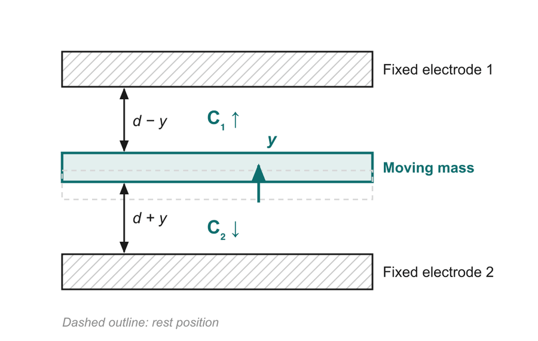

# 06 · Capacitive sensing: turning a sub-nanometre wiggle into a number

> After this page you should be able to explain why a moving plate changes capacitance, derive ΔC ≈ 2C₀·y/d, and walk through the signal chain on slide 13 from attofarads to °/s.

---

## 1. The capacitor you already know

A **parallel-plate capacitor** is two conducting plates facing each other with a gap between them.

$$C = \frac{\varepsilon_0 A}{d}$$

| Symbol | Meaning | Unit |
| --- | --- | --- |
| C | Capacitance: how much charge the plates store per volt | farad (F) |
| ε₀ | Permittivity of free space = 8.854 × 10⁻¹² F/m (vacuum or air) | F/m |
| A | Overlapping area of the plates | m² |
| d | Gap between the plates | m |

The important part for us: **C is inversely proportional to the gap d.** Push the plates closer and C goes up; pull them apart and C goes down. So **measuring C measures the gap**, and measuring the gap measures how far the proof mass moved.

> Analogy: two people on either side of a gully trying to hold hands. The narrower the gap, the stronger the "connection" between them.

## 2. The differential pair (slide 13)



*Diagram from slide 13. The dashed outline is the rest position.*

The moving mass sits **between two fixed electrodes**, forming two capacitors, C₁ (top) and C₂ (bottom). At rest both gaps equal d, so both capacitances equal C₀ = ε₀A/d.

When the mass moves up by a small distance y:
- top gap shrinks to d − y, so C₁ = ε₀A/(d − y) **rises**;
- bottom gap grows to d + y, so C₂ = ε₀A/(d + y) **falls**.

### Deriving ΔC ≈ 2C₀ · y/d

For small y (y ≪ d), use the approximation 1/(1 ∓ x) ≈ 1 ± x:

- C₁ = C₀ / (1 − y/d) ≈ C₀ (1 + y/d)
- C₂ = C₀ / (1 + y/d) ≈ C₀ (1 − y/d)

Subtract:

**ΔC = C₁ − C₂ ≈ C₀(1 + y/d) − C₀(1 − y/d) = 2C₀ · y/d**

That is the formula on slide 13.

### Why use a pair instead of one capacitor?

1. **Signal doubles.** Each capacitor alone changes by C₀·y/d; the difference changes by 2C₀·y/d.
2. **Common errors cancel.** Anything that changes *both* capacitors the same way (temperature changing ε or the dimensions, a drift in the bias voltage, stray capacitance to the package) appears in C₁ and C₂ equally and disappears in the subtraction. Engineers call this **common-mode rejection**.
3. **Better linearity.** The leftover error terms of the single capacitor (proportional to (y/d)²) cancel in the difference, so the output stays proportional to y over a wider range.

## 3. Worked example: how small is ΔC?

Use numbers consistent with [doc 04](04_coriolis_effect.md) (all assumed, illustrative):

- One sense electrode: length 500 µm, thickness 20 µm → A = 500 × 10⁻⁶ m × 20 × 10⁻⁶ m = **1 × 10⁻⁸ m²**
- Gap d = 2 µm = 2 × 10⁻⁶ m (the "sense gap" on the scale diagram in [doc 02](02_what_is_mems.md))
- Sense displacement y = 0.1 nm = 1 × 10⁻¹⁰ m (from the ≈ 2 nN Coriolis force at 1 rad/s)

**Rest capacitance:**
C₀ = (8.854 × 10⁻¹² F/m × 1 × 10⁻⁸ m²) / (2 × 10⁻⁶ m) ≈ **4.4 × 10⁻¹⁴ F = 44 fF** (femtofarads)

**Change:**
ΔC = 2C₀ · y/d = 2 × 4.4 × 10⁻¹⁴ × (1 × 10⁻¹⁰ / 2 × 10⁻⁶) = 2 × 4.4 × 10⁻¹⁴ × 5 × 10⁻⁵ ≈ **4.4 × 10⁻¹⁸ F ≈ 4 aF** (attofarads)

That is the "changes as small as attofarads (10⁻¹⁸ F)" on slide 13.

**Make it tangible.** Charge Q = C·V. With a 1 V bias across the capacitor, a 4.4 aF change moves 4.4 × 10⁻¹⁸ C of charge. One electron carries 1.6 × 10⁻¹⁹ C, so that is only about **28 electrons**. The readout electronics have to notice a few dozen electrons sloshing back and forth 20,000 times a second. That is why the readout chip is just as important as the silicon structure.

## 4. Comb fingers: more area, more signal

A single pair of plates gives tiny capacitance. To get more, designers use **many** plates in parallel, shaped like the teeth of two interlocking combs. Capacitors in parallel add, so 100 finger pairs give about 100× the capacitance and 100× the signal.


*Real MEMS gyroscope under an electron microscope. Panel (c) on the right shows comb fingers: the long thin teeth of the moving part slot between fixed teeth. Note the square holes in the central bar; these are release holes ([doc 09](09_fabrication.md)). SEM: M. N. Nguyen et al., CC BY 4.0, via Wikimedia Commons.*

Combs are used in two ways:
- **Drive combs** push the mass (apply a voltage → electrostatic attraction).
- **Sense combs/electrodes** measure the motion (capacitance change).

## 5. The signal chain: from attofarads to °/s

Slide 13's bottom row:

```
ΔC (attofarads) → C-to-V amplifier → Demodulator → Filter + ADC → Ω in °/s
                  charge → voltage    uses the drive   clean & digitise
                                      signal
```

| Stage | What it does | Analogy |
| --- | --- | --- |
| **C-to-V amplifier** (charge amplifier) | Converts the tiny charge change on the sense capacitors into a voltage big enough to work with | A microphone pre-amp for a whisper |
| **Demodulator** | The sense signal is an oscillation at the drive frequency (≈ 20 kHz) whose amplitude ∝ Ω. The demodulator multiplies it by a reference taken from the **drive** signal, then averages. Signals that are in step with the drive survive; noise at other frequencies averages away. The result is a slowly varying voltage ∝ Ω, **with sign**, so direction is kept | Listening for one friend's voice in a noisy canteen because you know exactly what rhythm they speak in |
| **Filter** | Removes the leftover high-frequency ripple and limits the bandwidth to what the application needs | Smoothing a shaky line |
| **ADC** (analogue-to-digital converter) | Turns the voltage into a number | |
| **Output** | Digital value read by the phone/car processor over I²C or SPI | |

The output number has a **sensitivity** (scale factor). For example, the MPU-6050 set to ±250 °/s gives **131 counts per °/s** (a 16-bit signed number spans ±32,768, and 32,768 / 250 ≈ 131) [S1]. So a reading of 1310 counts means 10 °/s.

### Why use the drive signal as reference?

- Only the part of the sense signal that is synchronised with the drive velocity is caused by rotation.
- Some unwanted signals (for example **quadrature error**, caused by tiny manufacturing imbalances that couple drive *position* into the sense axis) are a quarter cycle out of step. Demodulating with the right phase rejects them.

---

## Key points to remember

- **C = ε₀A/d**: smaller gap → larger capacitance, so capacitance measures position.
- The **differential pair** gives **ΔC ≈ 2C₀ · y/d**: double signal, common errors cancel, better linearity.
- Real changes are **attofarads** (10⁻¹⁸ F), equivalent to a few dozen electrons at 1 V.
- **Comb fingers** put many capacitors in parallel to multiply the signal.
- Signal chain: **C-to-V amp → demodulator (drive reference) → filter + ADC → Ω in °/s**.

**Which slide uses this:** Slide 13 ("Tiny gap changes become an electrical signal"), and step 4 of the animation (slide 10).

## Self-check

1. If the gap d is halved and nothing else changes, what happens to C₀?
2. Using ΔC ≈ 2C₀ · y/d, with C₀ = 50 fF, d = 2 µm and y = 0.2 nm, find ΔC.
3. Give two reasons for using two sense capacitors instead of one.
4. Why does the demodulator need a reference from the drive loop?

<details>
<summary>Answers</summary>

1. C₀ = ε₀A/d, so halving d **doubles** C₀.
2. ΔC = 2 × 50 × 10⁻¹⁵ × (0.2 × 10⁻⁹ / 2 × 10⁻⁶) = 2 × 50 × 10⁻¹⁵ × 10⁻⁴ = **1 × 10⁻¹⁷ F = 10 aF**.
3. Any two of: the signal doubles; common-mode errors (temperature, stray capacitance, voltage drift) cancel; linearity improves.
4. The rotation signal is an oscillation at the drive frequency, in step with the drive velocity. Multiplying by the drive reference converts it to a steady value proportional to Ω (keeping the sign/direction) and rejects noise and quadrature signals that are not in step.

</details>

---

### Sources
- Deck slide 13; references [1] Kempe, [3] Yazdi et al.
- [S1] InvenSense, *MPU-6000/MPU-6050 Product Specification* (gyro sensitivity 131 LSB/(°/s) at ±250 °/s).
- ε₀ = 8.854 × 10⁻¹² F/m and electron charge 1.602 × 10⁻¹⁹ C are standard physical constants.
- Electrode dimensions in the worked example are **assumed illustrative values**, not from a particular chip.
- Image credit: SEM of a MEMS gyroscope, M. N. Nguyen et al., CC BY 4.0, via Wikimedia Commons.
