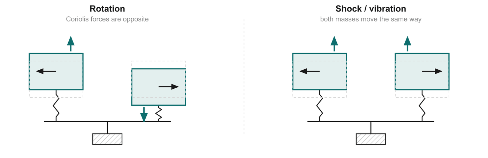
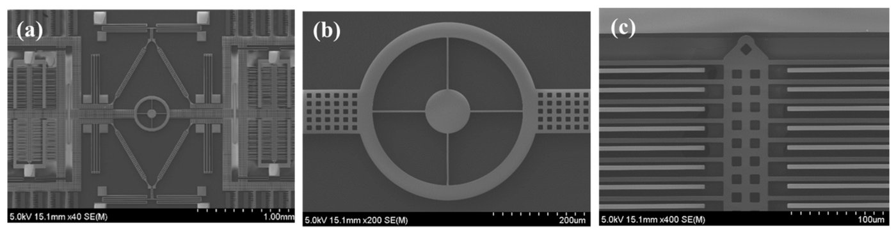

# 07 · The tuning-fork design: sense rotation, reject shocks

> After this page you should be able to explain why real MEMS gyros use **two** masses moving in opposite directions, and show with numbers how that cancels bumps and vibration.

---

## 1. The problem with a single mass

A single vibrating proof mass is pushed sideways (along its sense axis) by the Coriolis force when the chip rotates. Good. But it is **also** pushed sideways by anything else that accelerates the chip along that axis:

- the car going over a pothole,
- the phone being tapped or dropped,
- engine vibration, music from the speaker,
- even gravity, if the chip is tilted.

From F = ma, a sideways acceleration a pushes the mass with force m·a. The sense electrodes cannot tell **why** the mass moved. A single-mass gyro would mistake a bump for a rotation.

How big is the problem? Take the same 1 µg mass as before:
- Coriolis force at 1 rad/s ≈ **2 nN** ([doc 04](04_coriolis_effect.md)).
- A modest 5 g bump (5 × 9.81 m/s²): F = 10⁻⁹ kg × 49 m/s² ≈ **49 nN**, about **25 times larger** than the signal.

Cars and phones are full of vibration (slide 14), so this must be solved.

## 2. The trick: two masses in anti-phase

Think of a **tuning fork**: its two prongs vibrate towards each other and then away from each other, always moving in **opposite directions** (this is called **anti-phase**).

A tuning-fork gyro does the same with **two identical proof masses**:

*Diagram from slide 14.*

### Case 1: rotation (left panel)

- The left mass moves left while the right mass moves right: their velocities are **opposite**.
- F_c = −2m(Ω × v). Opposite v → **opposite Coriolis forces**: one mass is pushed up, the other down.
- Read both sense outputs and **subtract**:
  (+F) − (−F) = **2F → rotation detected (signal doubled)**

### Case 2: shock or vibration (right panel)

- A bump accelerates the whole chip, so **both** masses get pushed **the same way** by the same force (they have the same mass).
- Subtract: F_shock − F_shock = **0 → shock rejected**

### Both at once: worked numbers

Suppose the chip rotates at 1 rad/s (Coriolis ±2 nN) **and** hits a 5 g bump (≈ +49 nN on each mass, say upwards):

| | Coriolis | Bump | Total sideways force |
| --- | --- | --- | --- |
| Left mass | +2 nN | +49 nN | **+51 nN** |
| Right mass | −2 nN | +49 nN | **+47 nN** |
| **Difference (left − right)** | | | **4 nN = 2 × 2 nN** |

The 49 nN bump, 25× bigger than the signal, vanishes in the subtraction; what is left is exactly twice the Coriolis force.

This is the same "subtract to cancel what's common" idea as the **differential capacitor** in [doc 06](06_capacitive_sensing.md), but applied at the mechanical level.

## 3. A second benefit: a balanced, quieter structure

When two equal masses move in opposite directions, their momenta cancel: the structure as a whole does not shake its mounting. A single vibrating mass would push the anchor back and forth, leaking energy into the package and picking up disturbances from it. A balanced pair keeps the vibration energy inside the sensor, giving a cleaner, more stable resonance.

## 4. Real devices

*A fabricated tuning-fork gyroscope under an electron microscope. In panel (a) you can see the left–right symmetry: two large proof-mass frames full of comb fingers on either side of a central coupling structure. SEM: M. N. Nguyen et al., CC BY 4.0, via Wikimedia Commons.*

Points to note:
- Most commercial MEMS gyros use some form of two (or four) masses in anti-phase for exactly this reason.
- The cancellation is only as good as the **matching** of the two halves. Manufacturing makes them slightly different, so a little vibration still leaks through. This "vibration sensitivity" is one of the error sources in [doc 12](12_performance_challenges.md).

---

## Key points to remember

- A **single** vibrating mass cannot tell rotation from a bump: both push it sideways.
- A **tuning-fork** gyro drives **two identical masses in opposite directions** (anti-phase).
- **Rotation** gives **opposite** Coriolis forces → subtracting doubles the signal (2F).
- **Shock/vibration** pushes both masses **the same way** → subtracting cancels it (0).
- The balanced design also keeps vibration energy from leaking into the mount.

**Which slide uses this:** Slide 14 ("Two masses in opposition: sense rotation, reject shock").

## Self-check

1. Why do the two masses feel opposite Coriolis forces?
2. A chip has Coriolis forces of ±3 nN and a vibration force of +20 nN on each mass. What is the difference signal?
3. Why can't a single-mass gyro reject a bump?
4. Why is the cancellation never perfect in a real device?

Answers

1. Because they move with **opposite velocities**, and the Coriolis force −2m(Ω × v) reverses when v reverses.
2. Left: 3 + 20 = 23 nN; right: −3 + 20 = 17 nN; difference = **6 nN** = 2 × 3 nN. The 20 nN cancels.
3. Its sense electrodes only see that the mass moved sideways; a bump (F = ma) and the Coriolis force both move it the same way, with no second mass to compare against.
4. The two halves are never perfectly identical (mass, springs, gaps), so a common push produces slightly different motions and a small residue remains.

---

### Sources
- Deck slide 14; references [2] Acar & Shkel (structural approaches to robustness), [3] Yazdi et al.
- Image credit: SEM of tuning-fork gyroscope, M. N. Nguyen et al., CC BY 4.0, via Wikimedia Commons. Tuning-fork diagram: made by the team.
- The 5 g bump in the worked example is an **assumed illustrative value**.
