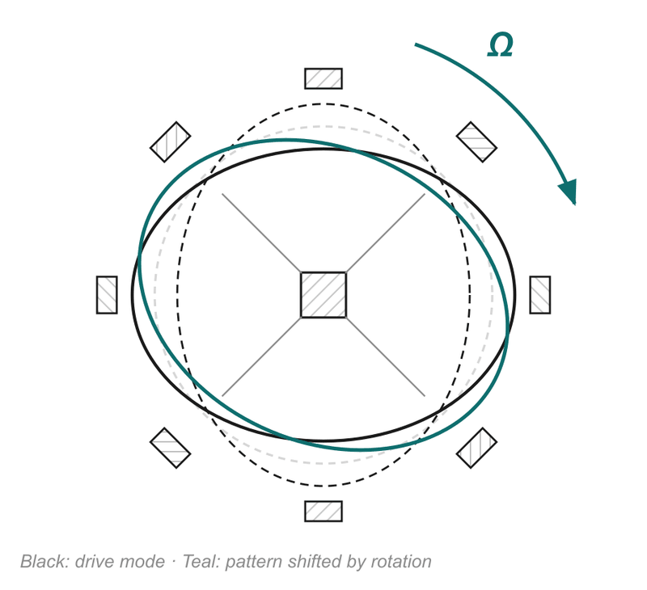
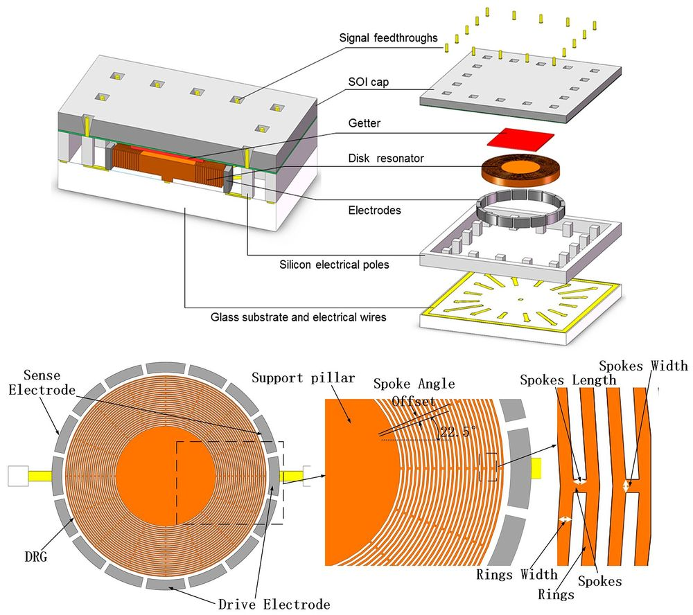

# 08 · Ring and disk resonators: rotation shifts the vibration pattern

> After this page you should be able to explain the "wine-glass mode", what Bryan noticed in 1890, why symmetry helps, and what "closed-loop (force-rebalance)" means on slide 15.

---

## 1. Start with a wine glass

Wet your finger and rub it round the rim of a wine glass (or tap a steel *katori* bowl). It sings. What is the rim actually doing?

It is flexing into an **ellipse**: squashed one way, then squashed the other way, back and forth at the ringing frequency. This shape of vibration is called the **wine-glass mode** (engineers call it the n = 2 mode, because two full waves fit round the circumference). An ellipse has 2 bulges and 2 pinches; together those are 4 points of maximum motion, called **antinodes**. Halfway between them, at 45°, are 4 points that hardly move, called **nodes**.



*Diagram from slide 15. The ring is held at its centre by spokes and surrounded by 8 electrodes (every 45°). Black ellipse: the vibration pattern set up by the drive electrodes. Teal ellipse: the pattern shifted round the ring when the device rotates.*

## 2. Bryan's discovery (1890)

In 1890 the physicist **G. H. Bryan** studied what happens to the ringing pattern of a vibrating bell or cylinder when the whole thing is rotated. He found the pattern **does not stay fixed to the bell**: rotation makes it move round the rim, and this shows up as "beats" in the sound, hence the title of his paper (deck reference [6]).

**Why?** It is the Coriolis effect again. Each little piece of the rim is moving in and out (radially). When the ring rotates, the Coriolis force on that radial motion pushes the piece **along** the rim (tangentially). Those tangential pushes excite a second ellipse pattern rotated by 45° from the first. The combination of the two looks like the original pattern turned to a new angle.

Important subtlety: the pattern only partly follows the rotation. It turns by a fixed **fraction** of the angle the ring turns (this fraction depends on the shape and is called the angular gain or Bryan factor). So, relative to the ring and its electrodes, the pattern appears to lag behind. The deck's phrase "rotation drags this pattern around the ring" is a fair simplification.

## 3. Mapping it onto drive and sense

The ring has **two** wine-glass modes, oriented 45° apart:

| | Tuning-fork gyro | Ring gyro |
| --- | --- | --- |
| Drive mode | Mass vibrates along x | Ring vibrates in ellipse #1 (aligned with drive electrodes at 0°, 90°, 180°, 270°) |
| Sense mode | Mass moves along y | Ellipse #2 appears, rotated 45° (picked up by electrodes at 45°, 135°, …) |
| What carries the rotation information | Sense amplitude ∝ Ω | Amount of ellipse #2 (equivalently, the shift of the pattern angle) |

The 8 electrodes in the diagram are split into drive, drive-pickoff, sense and feedback roles.

## 4. Why symmetry is such a big deal

Because a ring (or disk) is **perfectly symmetric**, ellipse #1 and ellipse #2 are the same shape just rotated, so they have **the same resonant frequency**. Engineers call this **mode matching**.

Why it helps:
- The sense mode is itself a resonator. If the Coriolis force pushes it **at its own resonant frequency** (which equals the drive frequency), the response is amplified by the resonator's quality factor Q, just like the swing analogy in [doc 05](05_vibrating_gyro_principle.md). Result: **much higher sensitivity** than a design whose sense frequency is deliberately offset.
- Symmetric shapes also tend to be less affected by temperature changes and shocks, since both modes change together.

The catch: real rings are never perfectly symmetric, so the two frequencies split slightly. Designs add **tuning electrodes** to pull them back into match.

## 5. Open loop vs. closed loop (force rebalance)

The bottom of slide 15 shows a feedback loop:

```
Resonator  →  Pick-off + controller  →  Feedback electrodes
(starts to move     (measures that motion)    (push it back to zero)
 along sense axis)
                         Output = feedback force ∝ Ω
```

**Open loop** (the simple way, used in docs 05–07): let the sense mode move, measure how far it moves, and call that the output.

**Closed loop (force rebalance):** the moment the sense mode starts to move, a controller applies an electrostatic force through the **feedback electrodes** that exactly cancels the Coriolis force and holds the sense motion at (almost) **zero**. The size of that cancelling force must equal the Coriolis force, which is ∝ Ω. So **the feedback force *is* the output.**

Everyday analogy: balancing a stick on your hand. You don't measure how far it falls; you measure how much you had to move your hand to keep it upright.

Why bother (slide 15: "wider range, faster response, better linearity"):

| Benefit | Reason |
| --- | --- |
| **Better linearity** | The mass stays near its rest position, so the nonlinear 1/d capacitance law and nonlinear spring effects never come into play. Output depends mainly on the well-known feedback actuator. |
| **Wider range** | In open loop, a big rotation could push the mass so far that it hits the electrode or goes nonlinear. Holding it at zero avoids that. |
| **Faster response** | A high-Q, mode-matched resonator on its own responds slowly (it takes many cycles for its motion to build up). The feedback loop does not wait for that build-up, so the bandwidth is set by the controller instead. |

Closed loop is not limited to rings; it is used in many high-performance MEMS gyros. Rings and disks are where it is most natural because their modes are matched.

## 6. Disk resonator gyroscope (DRG)



*Disk resonator gyro, exploded view and layout. The "disk" is many thin concentric rings linked by short spokes, anchored at a central support pillar, surrounded by drive and sense electrodes. A **getter** inside the vacuum cap soaks up stray gas molecules to keep the vacuum good. Xia et al., CC BY 4.0, via Wikimedia Commons.*

The DRG extends the ring idea: many nested rings give more mass and more electrode area while keeping the symmetric wine-glass modes. The same principle at large scale, in quartz, is the **hemispherical resonator gyroscope (HRG)**, the most stable gyro of all ([doc 10](10_types_of_gyroscopes.md)).

---

## Key points to remember

- A ring vibrates in an elliptical **wine-glass mode**; rotation **shifts the pattern** round the ring (**Bryan, 1890**).
- The rotation information is in the **second ellipse**, 45° from the drive pattern, read by electrodes at 45°.
- Symmetry makes drive and sense modes share **one frequency** (mode matching) → high sensitivity.
- **Closed-loop / force-rebalance:** hold the sense motion at zero; the **feedback force is the output** (∝ Ω).
- Closed loop gives **wider range, faster response and better linearity**.

**Which slide uses this:** Slide 15 ("Ring resonators: rotation shifts the vibration pattern").

## Self-check

1. What is a "wine-glass mode"?
2. Why does a symmetric ring give high sensitivity?
3. In force-rebalance operation, what is actually measured as the output?
4. Give one reason closed loop improves linearity.

<details>
<summary>Answers</summary>

1. The ring (or rim) flexes into an ellipse, squashing one way then the other, with 4 nodes and 4 antinodes round its circumference.
2. The drive and sense modes are identical shapes rotated 45°, so they share the same resonant frequency. The Coriolis force then drives the sense mode at resonance, and the response is amplified by the quality factor Q.
3. The **feedback force** (or the voltage that creates it) needed to keep the sense motion at zero. It equals the Coriolis force, so it is proportional to Ω.
4. The mass barely moves, so the nonlinear relation between gap and capacitance (C ∝ 1/d) and any spring nonlinearity never come into play.

</details>

---

### Sources
- Deck slide 15; reference [6] G. H. Bryan, "On the beats in the vibrations of a revolving cylinder or bell," *Proc. Cambridge Philos. Soc.* 7, 1890; reference [1] Kempe (mode matching, force rebalance); reference [3] Yazdi et al. (vibrating ring gyroscopes).
- Image credit: disk resonator gyroscope, D. Xia et al., CC BY 4.0, via Wikimedia Commons. Ring diagram: made by the team.
