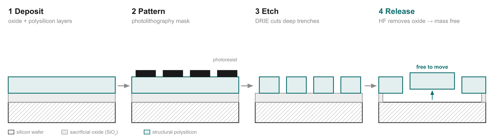
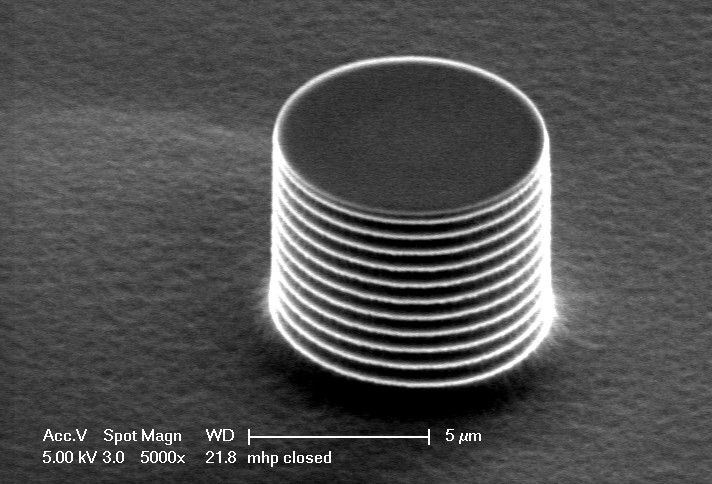

# 09 · Fabrication: built layer by layer, then set free

> After this page you should be able to explain the four steps on slide 16 (deposit, pattern, etch, release), plus the vacuum cap and batch fabrication, to someone who has never seen a cleanroom.

---

## 1. First, what is a cleanroom and a wafer?

- A **wafer** is a thin, polished disc of pure single-crystal silicon, like a very flat, shiny *roti* about 15–30 cm across and less than a millimetre thick. Thousands of chips are made on one wafer at the same time.
- A **cleanroom** is a factory room with extremely filtered air. A single speck of dust is bigger than the 2 µm gaps in a gyro, so one particle in the wrong place can ruin a device. Workers wear full-body "bunny suits", and the lighting in lithography areas is yellow because ordinary white light would expose the light-sensitive chemicals.

MEMS uses the **same toolset as computer-chip making** (slide 16). The difference is that MEMS must end up with parts that **move**.

## 2. The four steps (slide 16)

*Diagram from slide 16. Legend: hatched = silicon wafer, grey = sacrificial oxide (SiO₂), teal = structural polysilicon.*

Think of making a **table out of layers**: you want a tabletop floating above the floor, held up by legs. You first fill the space under the tabletop with something temporary (the "sacrificial" layer), build the tabletop on it, then wash the temporary filler away.

### Step 1 · Deposit

- Grow or deposit a thin layer of **silicon dioxide (SiO₂)**, the **sacrificial layer**. It is temporary: it will be removed in step 4. Its thickness sets the gap between the moving part and the substrate.
- On top, deposit the **structural layer** of **polysilicon** (silicon made of many small crystals). This is what the springs, masses and comb fingers will be made from.
- Deposition is done in furnaces or reaction chambers where gases react and leave a solid film on the wafer (chemical vapour deposition).

### Step 2 · Pattern (photolithography)

- Spin a light-sensitive liquid called **photoresist** onto the wafer.
- Shine UV light through a **mask** (a glass plate with the gyro's shape printed on it in chrome), like a stencil or a photographic negative.
- Develop it: the exposed (or unexposed, depending on the resist type) areas wash away, leaving resist only where you want silicon to stay (black blocks in the diagram).
- This is how the exact shapes of springs, masses and comb fingers are defined, all at once, across the whole wafer.

### Step 3 · Etch (deep reactive-ion etching, DRIE)

- Now cut away the polysilicon wherever it is **not** protected by photoresist, stopping at the oxide.
- Gyros need **tall, thin, vertical walls** (comb fingers maybe 2 µm apart but many times taller), so ordinary etching (which eats sideways as well as down) is no good.
- **DRIE** uses the **Bosch process**: it rapidly alternates two steps, many times:
  1. **Etch**: a plasma (SF₆ gas) eats a little way down.
  2. **Passivate**: a different gas (C₄F₈) coats every surface with a thin Teflon-like film.
  The next etch step, driven by ions travelling straight down, knocks the coating off the **floor** of the trench but not the **walls**, so the trench goes deeper while the walls stay protected and vertical. The process is named after Robert Bosch GmbH, which patented it. [S1]
- Result: trenches more than **20× deeper than they are wide** (slide 16).

*A silicon pillar cut by the Bosch DRIE process (scale bar 5 µm). The ripples on the side ("scallops") are the fingerprints of the alternating etch–coat cycles: each ridge is one cycle. Photo: Pgalajda, public domain, via Wikimedia Commons.*

### Step 4 · Release

- Dip (or expose) the wafer in **hydrofluoric acid (HF)**, which dissolves SiO₂ but barely touches silicon.
- The oxide **under** the moving parts dissolves away, so those parts now hang free, attached only by their springs to **anchors** (places where the oxide was left, or where the structure connects straight down to the wafer).
- Big flat parts like the proof mass have a grid of **small holes** (release holes; you can see them in the SEM photos in [doc 06](06_capacitive_sensing.md) and in the animation's proof mass) so the HF can reach underneath quickly.
- A practical headache: **stiction**. When a liquid dries out of a 2 µm gap, surface tension can pull the freed part down and glue it to the substrate. Factories avoid this with special drying methods such as supercritical CO₂ drying, which skips the liquid-to-gas step [S2], or by releasing with HF **vapour** so no liquid is involved at all.

## 3. After the four steps

### Vacuum cap

- A second wafer (the **cap wafer**) is bonded on top, sealing each gyro in its own tiny cavity under **vacuum** (slide 16).
- Why vacuum? Air molecules act like a brake on the vibrating mass (**air damping**). Removing the air lets the mass ring freely, so it reaches a large amplitude with little drive energy. This is called a **high quality factor (high Q)**. Higher Q → bigger, cleaner motion → better sensitivity and lower noise.
- Some designs include a **getter** (a material that soaks up stray gas molecules) inside the cavity to keep the vacuum good for years (see the disk-gyro picture in [doc 08](08_ring_resonators.md)).
- The cap also protects the fragile structure from dust and moisture.

### Then: test, cut, package

- The wafer is **diced** (sawn) into individual chips.
- Each MEMS chip is usually packaged together with a separate **readout chip** (ASIC: the C-to-V amplifier, demodulator, ADC, drive control loop from [doc 06](06_capacitive_sensing.md)).
- Each finished part is tested and **calibrated** (for example its bias and sensitivity measured at different temperatures, [doc 12](12_performance_challenges.md)).

## 4. Batch fabrication: why it's cheap

Every one of these steps processes the **whole wafer at once** (slide 16). A step that takes an hour does an hour's work on **thousands of gyros together**. That is the opposite of the hand-built Apollo IMU ([doc 03](03_history_big_to_small.md)), and it is the reason a gyro costs little enough to put in a phone.

## 5. Two names you may hear

- **Surface micromachining:** build the structure from thin films deposited on top of the wafer (what the diagram shows).
- **Bulk micromachining:** carve the structure out of the wafer itself, or out of a thick silicon layer bonded on top (for example SOI, silicon-on-insulator wafers, which come with a built-in oxide layer).

Many modern gyros mix the two ideas: a thick silicon layer for heavy proof masses (more mass → bigger Coriolis force), shaped with DRIE and released by removing an oxide underneath.

---

## Key points to remember

- **Deposit:** sacrificial oxide, then structural polysilicon.
- **Pattern:** photolithography prints the gyro's shape with UV light through a mask.
- **Etch:** **DRIE (Bosch process)** alternates etching and wall-coating to cut tall vertical trenches (> 20:1); the side-wall ridges are its fingerprint.
- **Release:** **HF** dissolves the oxide underneath so the mass is free; release holes let the HF in.
- **Vacuum cap** gives high Q; **batch fabrication** makes thousands per wafer.

**Which slide uses this:** Slide 16 ("Built layer by layer, then set free").

## Self-check

1. What is the "sacrificial" layer, and why is it called that?
2. Why can't ordinary etching be used for comb fingers, and how does DRIE solve this?
3. Why is the proof mass full of small holes?
4. Why is the gyro sealed in vacuum?

Answers

1. The silicon dioxide layer under the structural polysilicon. It is only there to hold up the structure during processing and is dissolved away ("sacrificed") at the release step to leave a gap.
2. Ordinary etching eats sideways as well as downwards, giving sloped or undercut walls. DRIE alternates a downward plasma etch with a protective wall coating, so the trench deepens while the walls stay vertical, reaching depths over 20× the width.
3. They are release holes: they let the HF reach and dissolve the oxide under the wide mass quickly.
4. Air damping would slow the vibration. Vacuum gives a high quality factor (Q), so the mass vibrates with a large, clean amplitude, improving sensitivity and noise.

---

### Sources
- Deck slide 16; references [1] Kempe, [3] Yazdi et al.
- [S1] [Wikipedia: Deep reactive-ion etching](https://en.wikipedia.org/wiki/Deep_reactive-ion_etching) (Bosch process: alternating SF₆ etch and C₄F₈ passivation; scalloped sidewalls).
- [S2] [Wikipedia: Stiction](https://en.wikipedia.org/wiki/Stiction) (stiction during wet release and drying in surface micromachining; supercritical CO₂ drying as a remedy).
- Image credit: DRIE pillar SEM, Pgalajda, public domain, via Wikimedia Commons. Process diagram: made by the team.
