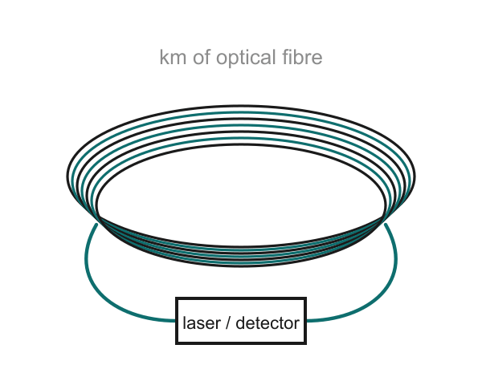

# 10 · Types of gyroscopes: MEMS trades precision for size, power and cost

> After this page you should be able to describe the five gyro types on slide 17 in one line each, explain the Sagnac effect simply, and read the bias-stability chart.

---

## 1. The five types at a glance

| Type | How it senses rotation | Typical home (slide 17) | Size / cost (rough) |
| --- | --- | --- | --- |
| **Mechanical** (spinning wheel) | A fast-spinning wheel resists changes in direction (angular momentum) | Early aircraft, ships | Large, heavy, moving parts, bearings wear |
| **Ring laser (RLG)** | Two laser beams circulate in opposite directions round a closed loop; rotation shifts their **frequencies** | Airliners | Box-sized, expensive |
| **Fibre-optic (FOG)** | Light sent both ways round a long coil of optical fibre; rotation shifts their **phase** | Submarines, satellites | Coil of fibre, medium–large, expensive |
| **Hemispherical resonator (HRG)** | A quartz "wine glass" vibrates; rotation shifts the vibration pattern (Bryan effect) | Spacecraft | Precision-machined quartz, very expensive |
| **MEMS** | A vibrating silicon mass feels the Coriolis force | Phones, cars, drones | Millimetres, milliwatts, very cheap |

## 2. A little more on each

### Mechanical
The classic spinning-wheel gyro from [doc 03](03_history_big_to_small.md). The best ones (floated, carefully balanced) were very good, but they need motors, bearings and maintenance, and they take time to spin up.

### The Sagnac effect (for both optical gyros)

Imagine two runners starting together on a circular track and running in **opposite directions** at the same speed, aiming to finish back at the start line. If the track itself (with the start line painted on it) is slowly rotating, the runner going *with* the rotation has to run a bit further to reach the moving finish line, and the one going *against* it runs a bit less. They no longer arrive together.

Replace the runners with light beams: that time difference is the **Sagnac effect** (Georges Sagnac, 1913) [S1]. The faster the loop rotates, the bigger the difference.

- **Ring laser gyro (RLG):** the loop is a laser cavity made of mirrors (often a triangular glass block). The two counter-running beams settle at slightly **different frequencies** when the loop rotates; mixing them gives a beat frequency proportional to the rotation rate. At very low rotation rates the two beams tend to lock together ("lock-in"), so many RLGs are mechanically jiggled ("dithered") to avoid this. [S2]
- **Fibre-optic gyro (FOG):** light goes both ways round a coil of fibre that can be hundreds of metres to kilometres long. Rotation creates a **phase difference** between the beams, measured by interference.



*Fibre-optic gyro sketch made for the deck: kilometres of fibre wound into a coil, connected to a laser source and detector.*

**Why so much fibre? A worked example.** The FOG phase shift is

Δφ = (2π L D / λ c) · Ω  [S1]

where L = fibre length, D = coil diameter, λ = light wavelength, c = speed of light.

Take L = 1 km = 1000 m, D = 0.1 m, λ = 1.55 µm (a common telecom wavelength), c = 3 × 10⁸ m/s, and the Earth's rotation Ω = 7.29 × 10⁻⁵ rad/s:

- 2π × 1000 × 0.1 / (1.55 × 10⁻⁶ × 3 × 10⁸) = 628.3 / 465 ≈ 1.35 s (rad per rad/s)
- Δφ ≈ 1.35 × 7.29 × 10⁻⁵ ≈ **1 × 10⁻⁴ rad**

A tenth of a milliradian, even with a kilometre of fibre. Δφ grows with L, so more fibre means more sensitivity. This is why precision FOGs are large and why they cannot simply be shrunk onto a chip.

### Hemispherical resonator gyro (HRG)
A precisely machined **quartz hemisphere** (like an upside-down wine glass) vibrating in its wine-glass mode inside a vacuum. Rotation shifts the vibration pattern, exactly the Bryan effect from [doc 08](08_ring_resonators.md). Quartz has extremely low internal losses, so the pattern rings very cleanly. The deck's notes call it "the most stable of all".

### MEMS
The subject of this whole talk: a vibrating silicon proof mass + Coriolis force + capacitive readout. Least precise of the five, but tiny, low-power, robust and cheap.

## 3. What is "bias stability"?

When a gyro is perfectly still it should output 0 °/s. In reality it outputs a small offset called the **bias**. Worse, that bias **wanders** slowly. **Bias stability** (or **bias instability**) is a measure of how much the bias wanders, in **°/h** (degrees per hour). **Lower is better.** ([Doc 12](12_performance_challenges.md) explains how it is measured from an Allan deviation plot.)

Why it matters: when you integrate rate to get angle, a bias of b °/h produces an angle error that grows by b degrees every hour.

## 4. The bias-stability comparison (slide 17)

Slide 17 shows approximate ranges on a **logarithmic** axis from 0.0001 to 100 °/h. As drawn on the slide (approximate, from published specifications):

| Type | Approx. bias stability range shown (°/h) |
| --- | --- |
| Hemispherical (HRG) | ~0.0001 – 0.005 (best) |
| Ring laser (RLG) | ~0.0005 – 0.01 |
| Fibre-optic (FOG) | ~0.0005 – 1 |
| Mechanical | ~0.001 – 1 |
| MEMS | ~0.05 – 100 (worst, widest range) |

How to read a log axis: each gridline is **10× bigger** than the one before. MEMS at ~10 °/h vs. a navigation-grade optical gyro at ~0.01 °/h is a factor of 1000: "thousands of times worse", as the speaker notes say.

### Translate into heading error after one hour (slide 21 uses the same idea)

| Grade | Bias | Heading error after 1 h from bias alone |
| --- | --- | --- |
| Consumer MEMS | 10 °/h | 10° |
| Tactical grade | 1 °/h | 1° |
| Navigation grade | 0.01 °/h | 0.01° |

A 10° heading error after an hour is fine for a phone game (the phone constantly corrects itself using other sensors) but useless for a submarine navigating blind for days.

## 5. The trade-off in one picture

```
           precision  ↑
   HRG, RLG, FOG      |   big, power-hungry, expensive
                      |
   Mechanical         |
                      |
   MEMS               |   tiny, milliwatts, cheap, rugged
                      +-------------------------------→ size / power / cost
```

- **Optical and HRG gyros** win on precision; they are used where nothing else will do (aircraft, submarines, spacecraft).
- **MEMS** wins on size (mm), power (mW), robustness (no moving bearings, 10,000 g shocks) and cost (batch fabrication). It is "good enough" for phones, cars and drones, especially when fused with other sensors ([doc 13](13_sensor_fusion_future.md)).
- The precision gap is the main limitation of MEMS, and it returns on slide 21.

---

## Key points to remember

- Five types: **mechanical** (spinning wheel), **RLG** (laser frequency shift), **FOG** (fibre phase shift), **HRG** (vibrating quartz bell), **MEMS** (vibrating silicon, Coriolis).
- Optical gyros use the **Sagnac effect**: light going round a rotating loop takes different times in the two directions.
- **Bias stability** (°/h, lower is better) is the key precision number.
- On slide 17, MEMS spans roughly **0.05–100 °/h**, about **1000×** worse than navigation-grade optical gyros at the consumer end.
- MEMS trades precision for **size, power, robustness and cost**.

**Which slide uses this:** Slide 17 ("MEMS trades precision for size, power and cost").

## Self-check

1. In one sentence each, how do an RLG and a FOG sense rotation?
2. Why does a FOG use hundreds of metres to kilometres of fibre?
3. A gyro has a bias stability of 0.5 °/h. Roughly how much heading error builds up in 4 hours from bias alone?
4. Why is MEMS used in phones even though it is the least precise?

<details>
<summary>Answers</summary>

1. RLG: two laser beams travel opposite ways round a mirror loop, and rotation makes their frequencies differ. FOG: light travels both ways round a fibre coil, and rotation makes their phases differ.
2. The Sagnac phase shift is proportional to fibre length (Δφ ∝ L·D·Ω), and it is tiny, so long fibre is needed to make it measurable.
3. 0.5 °/h × 4 h = **2°**.
4. It is tiny, low-power, robust and very cheap, and its drift can be corrected by fusing it with the accelerometer and magnetometer.

</details>

---

### Sources
- Deck slide 17 and its speaker notes; references [4] Passaro et al., "Gyroscope technology and applications: a review in the industrial perspective," *Sensors* 2017; [5] IEEE Std 952.
- [S1] [Wikipedia: Sagnac effect](https://en.wikipedia.org/wiki/Sagnac_effect) (Sagnac 1913; Δφ ≈ 8πAΩ/(λc) for a loop of area A). For a coil of N turns of diameter D, the total area is N·πD²/4 and the fibre length is L = N·πD, so the total area = L·D/4, giving Δφ = 2πLDΩ/(λc). [Wikipedia: Fibre-optic gyroscope](https://en.wikipedia.org/wiki/Fibre-optic_gyroscope) notes coils can be as long as 5 km.
- [S2] [Wikipedia: Ring laser gyroscope](https://en.wikipedia.org/wiki/Ring_laser_gyroscope) (beat frequency; lock-in and dither).
- The FOG coil dimensions in the worked example are **assumed illustrative values**.
- FOG sketch: made by the team for the deck.
