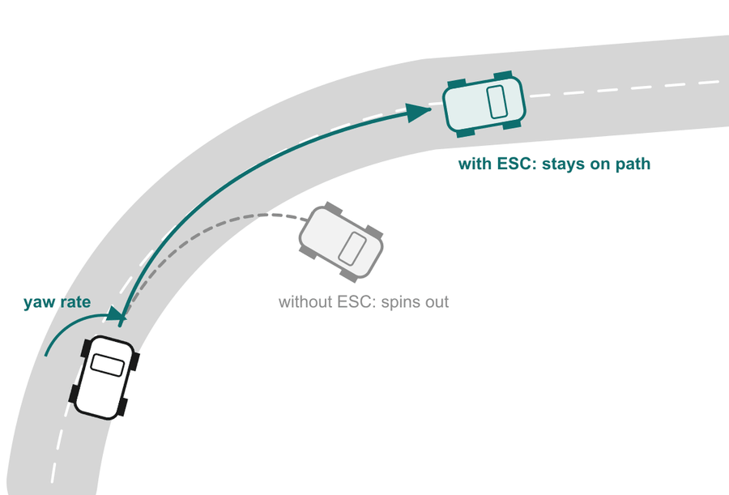

# 11 · Applications: phones, cars, drones and Mars

> After this page you should be able to explain slides 18–20: how the gyro helps your phone camera, how it stops a car from spinning out, and how vehicles navigate where GPS cannot reach.

---

## Part A · Consumer electronics (slide 18)

The biggest market for MEMS gyros is consumer devices. Most smartphones carry one (not every budget model does; say "most" if asked).

### Camera stabilisation (OIS)

When you take a photo, especially in low light, the shutter stays open for a fraction of a second. Your hand shakes slightly during that time, and the image smears.

**Optical image stabilisation (OIS)** fixes this, step by step (slide 18):

```
Hand shakes → Gyro measures → OIS controller → Actuator → Sharp photo
tiny tremor   rotation in °/s   computes          moves lens   no blur
                                correction        opposite
```

1. Your hand makes a tiny tremor, mostly small **rotations** (pitch and yaw) of the phone.
2. The gyro measures that rotation rate in °/s.
3. The OIS controller integrates the rate to get how far the phone has tilted, and computes the correction.
4. A tiny actuator (usually a voice-coil motor) shifts the lens (or the image sensor) the **opposite** way, so the image stays still on the sensor.
5. Result: a sharp photo.

Why a gyro and not an accelerometer? Hand shake that blurs photos is mostly **angular** (the camera tilting), and the gyro measures that directly, quickly and smoothly. Over the fraction of a second of an exposure, gyro drift is negligible.

### AR / VR head tracking

In a VR headset, when you turn your head the picture must update **immediately**, or your eyes and inner ear disagree and you feel motion sickness. The gyro reports head rotation **hundreds of times a second** (slide 18), so the image keeps up with your head.

### Also inside your phone (slide 18)

| Feature | What the gyro does |
| --- | --- |
| **Gaming: steer by tilting** | Measures how fast you twist the phone, making steering smooth |
| **Panorama & 360° photos** | Tracks how far you have turned, to stitch images |
| **Step and turn counting** in fitness apps | Helps detect turns and movement patterns |
| **Indoor navigation when GPS is weak** | Tracks turns between known points (a short burst of dead reckoning, see Part C) |
| **Screen rotation** | Mostly the **accelerometer** (it knows where "down" is); the gyro helps make it fast and smooth |

## Part B · Automotive safety (slide 19)

### Electronic Stability Control (ESC)



*Diagram from slide 19.*

The danger: on a slippery or fast curve, a car can **oversteer** (the rear slides out and the car spins) or **understeer** (the front slides and the car ploughs straight on). The driver often cannot react in time.

ESC works in three steps (slide 19):

1. **Expected turn.** From the **steering angle** and **speed**, the ESC computer calculates how fast the car *should* be rotating (the expected **yaw rate**).
2. **Actual turn.** The **MEMS yaw-rate gyro** measures how fast the car *is* rotating.
3. **Mismatch? Brake one wheel.** If the two differ, ESC brakes a single wheel to create a turning force that pulls the car back onto the intended path. Typically it brakes the **outer front** wheel to counter oversteer and the **inner rear** wheel to counter understeer. [S1]

**Worked example (simplified).** A car drives at 72 km/h = 20 m/s with a wheelbase L = 2.5 m. The front wheels are steered by δ = 2° = 0.0349 rad. A simple low-speed "bicycle model" estimate of the expected yaw rate is

r ≈ v·δ / L = 20 × 0.0349 / 2.5 ≈ 0.28 rad/s ≈ **16 °/s**.

(Real ESC uses a more detailed vehicle model that accounts for tyre grip and speed; this is just to show the idea.)
- If the gyro reads **≈ 16 °/s**: all is well, do nothing.
- If the gyro reads **25 °/s**: the car is rotating **more** than the driver asked → **oversteer**, spinning out → brake the outer front wheel.
- If the gyro reads **8 °/s**: the car is rotating **less** than asked → **understeer**, sliding wide → brake the inner rear wheel.

Note what the gyro needs here: a moderate range (tens of °/s), fast response, and reliability for the car's lifetime. It does **not** need navigation-grade precision, because ESC compares rates moment by moment and never integrates for hours. This is a perfect job for MEMS.

### Impact (slide 19)

- **–48%**: the 2025 US DOT / NHTSA evaluation of ESC found a **47.7%** relative reduction in the risk of first-event, single-vehicle rollover crashes for vehicles with ESC (using US crash data from 2013–2015). The slide rounds this to –48%; the notes say "about half". [S2]
- **Mandatory:** ESC became required on all new passenger vehicles in the **USA** from the **2012** model year, and on all newly registered cars in the **EU** from **November 2014**. [S1]

### Rollover detection

A **roll-rate gyro** plus an **accelerometer** watch how fast the car is tipping sideways. If the combination predicts a rollover, the system fires the **curtain airbags** early enough to protect occupants' heads (slide 19).

## Part C · Aerospace and robotics (slide 20)

### Where GPS fails (slide 20)

GPS needs a clear view of satellites. It does not work, or works badly:
- in **tunnels and mines**,
- **inside buildings**,
- **underwater** (radio waves do not travel far in water),
- in **space and on other planets** (there is no GPS around Mars),
- in areas with **signal jamming**.

### Dead reckoning: navigating with no outside signal

```
Known start → Gyroscope → Accelerometer → Integrate → Current position
position &    how am I     how am I         over time     no GPS needed
heading       turning?     speeding up?
```

Like a sailor before satellites: "I started here, I've been heading north-east at 10 knots for 2 hours, so I'm about there."

1. Start from a **known position and heading**.
2. The **gyro** tells you how you are **turning**; integrate it to keep track of heading.
3. The **accelerometer** tells you how you are **speeding up**; integrate once for velocity, twice for position (using the heading to know which way).
4. Keep integrating to get the **current position**.

**The catch** (speaker notes): integration accumulates small errors. Illustrative numbers:
- A gyro bias of 10 °/h gives a heading error of 10° after 1 hour.
- An accelerometer bias of just 0.01 m/s² (about 1 thousandth of g), integrated twice for 60 s, gives a position error of ½ × 0.01 × 60² = **18 m** after only one minute, and it grows as t². 

That's why pure MEMS dead reckoning works only for short gaps (a tunnel, a few seconds of lost signal), and why sensor fusion matters ([docs 12](12_performance_challenges.md)–[13](13_sensor_fusion_future.md)).

### Drones

A quadcopter is naturally unstable, like balancing a plate on a stick. Its **flight controller reads the gyro thousands of times a second** (slide 20) and adjusts the four motor speeds to stay level. Without that fast rotation feedback, a quadcopter could not hold itself level and would quickly tip over.

### Mars: no GPS at all

NASA's **Ingenuity** helicopter (which flew on Mars from 2021) navigated using a **phone-grade MEMS IMU (Bosch BMI160)** plus a **downward-looking camera**, together with a laser rangefinder for altitude. The IMU alone would drift quickly; the camera tracked features on the ground to correct the drift. [S3] (Deck reference [10] notes the BMI160 on Ingenuity.)

That is a great talking point: the same kind of chip as in a phone, helping fly a helicopter on another planet, because it is light, low-power and survives launch shocks.

---

## Key points to remember

- **OIS:** gyro measures hand shake → lens moved the opposite way → sharp photo. **AR/VR:** head rotation read hundreds of times a second.
- **ESC:** compares **expected** yaw rate (steering + speed) with **actual** yaw rate (gyro); brakes one wheel on mismatch.
- NHTSA (2025): ESC cut first-event single-vehicle rollover risk by **≈ 48%** (47.7%); mandatory in the **US (2012)** and **EU (2014)**.
- **Dead reckoning** = known start + gyro (turning) + accelerometer (speeding up), integrated over time; it drifts.
- Drones read the gyro **thousands of times a second**; **Ingenuity** flew on Mars with a phone-grade MEMS IMU plus a camera.

**Which slide uses this:** Slides 18 (consumer), 19 (automotive) and 20 (aerospace & robotics).

## Self-check

1. In OIS, which way does the lens move, and why?
2. ESC's expected yaw rate is 20 °/s but the gyro reads 30 °/s. Oversteer or understeer? Which wheel is typically braked?
3. Name three places where GPS does not work.
4. Why can a phone-grade gyro be good enough for ESC but not for navigating a submarine?

<details>
<summary>Answers</summary>

1. Opposite to the measured hand rotation, so the image stays still on the sensor during the exposure.
2. The car is rotating more than intended: **oversteer** (spinning out). Typically the **outer front** wheel is braked.
3. Any three: tunnels/mines, inside buildings, underwater, in space/on other planets, under jamming.
4. ESC compares rates moment by moment and never integrates for long, so drift doesn't matter. Submarine navigation integrates for days, so a 10 °/h bias would build up huge heading errors.

</details>

---

### Sources
- Deck slides 18–20 and speaker notes; references [8] Dang (NHTSA 2007), [9] NHTSA 2025 update, [10] Bosch Sensortec.
- [S1] [Wikipedia: Electronic stability control](https://en.wikipedia.org/wiki/Electronic_stability_control) (yaw sensor vs. steering angle; outer front wheel for oversteer, inner rear for understeer; US 2012 model year; EU from 1 November 2014).
- [S2] C. N. Webb, *Evaluation of Electronic Stability Control: FMVSS No. 126, an Update*, NHTSA, DOT HS 813 749, 2025, [crashstats.nhtsa.dot.gov/Api/Public/Publication/813749](https://crashstats.nhtsa.dot.gov/Api/Public/Publication/813749) (47.7% relative risk reduction in first-event single-vehicle rollovers; 2013–2015 GES data).
- [S3] PickNik, ["How Ingenuity knows where it is and where it's going"](https://picknik.ai/slam/localization/state%20estimation/mars%20helicopter/2021/05/10/Ingenuity.html), 2021, and IEEE Spectrum, ["How NASA designed a helicopter that could fly autonomously on Mars"](https://spectrum.ieee.org/automaton/aerospace/robotic-exploration/nasa-designed-perseverance-helicopter-rover-fly-autonomously-mars) (Bosch BMI160 IMU, Garmin Lidar-Lite v3 rangefinder, downward-looking camera).
- Car speed, wheelbase, steering angle and accelerometer bias in the worked examples are **assumed illustrative values**.
- ESC diagram: made by the team.
