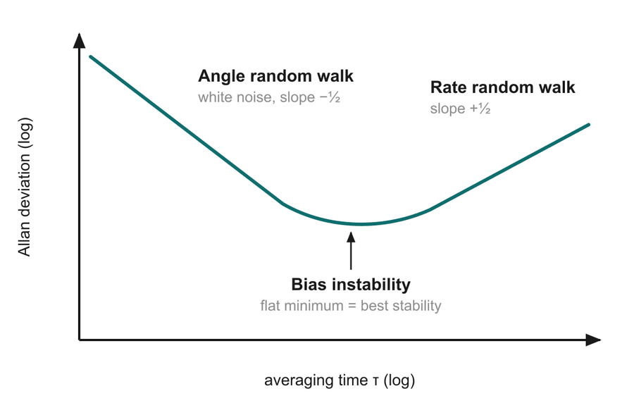

# 12 · Performance challenges: noise, drift and the Allan plot

> After this page you should be able to explain why small gyro errors grow when you integrate, the difference between angle random walk and bias drift (with units), and how to read the Allan deviation plot on slide 21.

---

## 1. The core problem: integration piles up errors

A gyro measures **rate** (°/s). To know the **angle** you must integrate:

angle(t) = ∫ rate dt ≈ sum of (rate × Δt) over every time step

Any error in the rate gets added up too. Two kinds of rate error behave very differently when integrated:

| Error type | What it looks like on the rate signal | What happens to the angle | Unit |
| --- | --- | --- | --- |
| **Angle random walk (ARW)** | Fast, random fuzz (white noise) around the true value | Random wandering; error grows like **√t** | °/√h |
| **Bias drift / bias instability** | A small offset that slowly wanders | Steady build-up; error grows like **t** | °/h |

Analogy: walking home from the canteen.
- **ARW** is like a slightly tipsy friend who takes random small steps left or right: they wander off the path, but slowly, because the random steps partly cancel (√t).
- **Bias** is like a friend who, without noticing, always leans a little to the left: every step adds to the error, so they drift off steadily (t).

## 2. Angle random walk (ARW)

- Cause: **white noise** on the rate output, mainly thermal (Brownian) motion of the tiny proof mass and electronic noise in the readout.
- Integrating white noise gives a "random walk" in angle. The typical (standard-deviation) angle error after time t is:

  **σ_θ(t) = ARW × √t**

- Unit: if ARW is in **°/√h** and t in hours, σ_θ is in degrees.

**Worked example.** A gyro with ARW = 0.3 °/√h:
- after 1 h: 0.3 × √1 = **0.3°**
- after 4 h: 0.3 × √4 = **0.6°** (4× the time, only 2× the error)
- after 1 min: 0.3 × √(1/60) ≈ 0.3 × 0.129 ≈ **0.04°**

**Where does 0.3 °/√h come from?** Datasheets often give noise as a **rate noise density** in °/s/√Hz. To convert: ARW (°/√h) = noise density (°/s/√Hz) × 60. For example the MPU-6050 lists a rate noise spectral density of 0.005 °/s/√Hz [S1], giving 0.005 × 60 = **0.3 °/√h**.

(Why × 60? 1 °/s/√Hz = 1 °/√s, and 1/√s = √3600/√h = 60/√h.)

## 3. Bias drift and bias instability

- **Bias** (zero-rate offset): the output when the true rotation is zero. If it were perfectly constant you could measure it once and subtract it.
- The trouble is it **wanders**: with time, temperature, mechanical stress, ageing. The slowest, unpredictable wander is called **bias instability** (bias stability).
- Integrating a bias b gives an angle error **θ_error = b × t**: linear growth, no cancelling.

**Worked example (slide 21).** A consumer MEMS gyro with a bias of 10 °/h:
- after 6 min (0.1 h): 1°
- after 60 min: **10°**, as the slide's chart and speaker notes say ("off by 10° after one hour").

The chart on slide 21 plots exactly this for three grades over 60 minutes:

| Time (min) | Consumer MEMS (10 °/h) | Tactical (1 °/h) | Navigation (0.01 °/h) |
| --- | --- | --- | --- |
| 10 | 1.67° | 0.17° | 0.0017° |
| 30 | 5.0° | 0.5° | 0.005° |
| 60 | 10.0° | 1.0° | 0.01° |

Because it grows linearly forever, bias drift is "the main limit for navigation" (slide 21). ARW dominates at short times; bias dominates at long times.

**Compare with the Earth.** The Earth turns at 15 °/h. A consumer gyro's 10 °/h bias is the same order of magnitude, so it cannot detect the Earth's rotation (and so cannot find north on its own, which navigation-grade gyros can do).

## 4. Other errors (slide 21: "temperature changes, vibration, ageing")

| Error | What it is | How it is handled |
| --- | --- | --- |
| **Temperature sensitivity** | Bias and sensitivity change as the chip warms or cools (springs stiffen/soften, gaps change, electronics drift) | Factory calibration over temperature; on-chip temperature sensor; compensation tables |
| **Vibration / shock sensitivity** | Imperfect tuning-fork matching lets some linear vibration leak into the output ([doc 07](07_tuning_fork.md)) | Better symmetry, mechanical isolation |
| **Scale-factor error** | The output per °/s is slightly wrong (e.g. reads 101 °/s for a true 100 °/s) | Calibration |
| **Ageing** | Slow changes in the package stress and material properties over years | Periodic re-calibration, fusion with other sensors |
| **Turn-on bias variation** | The bias is slightly different each time the device is switched on | Measure the bias at start-up while the device is still |

## 5. Reading the Allan deviation plot

*Diagram from slide 21 (shape only; no numbers on the axes).*

### How the plot is made (the idea)

1. Put the gyro on a still, temperature-stable table and record its output for **hours** (the true rate is ~0).
2. Choose an **averaging time τ** (say 1 s). Chop the recording into chunks of length τ and average each chunk.
3. Look at how much **consecutive averages differ** from each other. That spread is the **Allan deviation** σ(τ) (in °/s or °/h).
4. Repeat for many τ (0.01 s, 0.1 s, 1 s, 10 s … 1000s of s) and plot σ(τ) against τ on **log–log** axes.

Intuition: averaging over longer τ smooths out random noise, so σ falls; but if you average too long, slow drifts start to show up between chunks, so σ rises again. The bottom of the "bathtub" is the best you can do.

### What each part means

| Region of the curve | Slope on log–log plot | Noise type | How to read the number |
| --- | --- | --- | --- |
| Left (short τ), falling | **−½** | **Angle random walk** (white rate noise) | ARW = the value of the −½ line at **τ = 1** (in matching units: read at τ = 1 h for °/√h, or at τ = 1 s for °/√s and then × 60) |
| Bottom, flat | **0** | **Bias instability** | Bias instability ≈ (minimum σ) / 0.664 [S2] |
| Right (long τ), rising | **+½** | **Rate random walk** (the bias itself random-walking) | Read the +½ line at τ = 3 (in matching units) [S2] |

**Worked example.** Suppose the plot shows σ(τ = 1 s) = 0.005 °/s on the −½ line, and a flat minimum of 6.6 °/h:
- ARW = 0.005 °/√s = 0.005 × 60 = **0.3 °/√h**
- Bias instability ≈ 6.6 / 0.664 ≈ **10 °/h** (a typical consumer MEMS gyro)

The value of this plot (slide 21 notes): **one test, one curve, and you can read both the ARW and the bias instability** (plus rate random walk). That is why the IEEE standard for gyro testing uses it (deck reference [5]).

## 6. Why this leads to sensor fusion

A MEMS gyro on its own:
- is excellent for **short** times (low ARW over seconds, very fast response),
- is poor for **long** times (bias drift adds up linearly).

So we need something that is **bad short-term but good long-term** to correct it. That is the accelerometer (for tilt) and magnetometer (for heading), combined in a fusion filter: the next doc.

---

## Key points to remember

- Gyros measure rate; integrating to angle **accumulates errors**.
- **ARW** (white noise, unit **°/√h**): angle error grows like **√t**.
- **Bias drift** (wandering offset, unit **°/h**): angle error grows like **t**; 10 °/h → **10° after 1 hour**. It is the main limit for navigation.
- Other errors: **temperature**, **vibration**, **scale factor**, **ageing**.
- The **Allan deviation plot**: −½ slope → ARW; flat minimum → bias instability; +½ slope → rate random walk.

**Which slide uses this:** Slide 21 ("Small errors add up: noise and drift").

## Self-check

1. A gyro has ARW = 0.2 °/√h. What is the typical angle error after 9 hours due to ARW alone?
2. The same gyro has a bias of 2 °/h. What angle error does that cause after 9 hours?
3. On an Allan deviation plot, where do you read the bias instability?
4. Why does bias drift matter more than ARW for long navigation?

Answers

1. 0.2 × √9 = 0.2 × 3 = **0.6°**.
2. 2 °/h × 9 h = **18°**.
3. At the **flat minimum** of the curve (bias instability ≈ minimum value / 0.664).
4. ARW error grows like √t but bias error grows like t, so over long times the bias error becomes much larger (18° vs 0.6° in the example above).

---

### Sources
- Deck slide 21 and speaker notes; reference [5] IEEE Std 952 (Allan variance method); reference [1] Kempe.
- [S1] InvenSense, *MPU-6000/MPU-6050 Product Specification* (gyroscope rate noise spectral density 0.005 °/s/√Hz).
- [S2] IEEE Std 952, Annex C (Allan variance): bias instability read from the flat region as σ_min/0.664 (equivalently σ_min ≈ 0.664 B); rate random walk read on the +½ slope at τ = 3. Summarised in [Wikipedia: Allan variance](https://en.wikipedia.org/wiki/Allan_variance).
- The Allan-plot numbers in the worked example are **illustrative**, chosen to match the deck's 10 °/h consumer figure.
