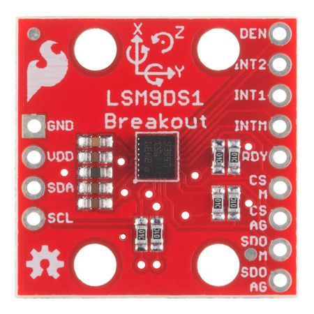

# 13 · Sensor fusion and the future

> After this page you should be able to explain why we combine a gyro with an accelerometer and magnetometer, work through the complementary filter on slide 22 with numbers, and name the future trends.

---

## 1. No single sensor is perfect, but their weaknesses differ

| Sensor | Good at | Bad at |
| --- | --- | --- |
| **Gyroscope** | Fast and smooth; tracks quick turns accurately over short times | **Drifts** over long times (bias builds up, [doc 12](12_performance_challenges.md)) |
| **Accelerometer** | Knows which way is **down** from gravity, and doesn't drift for tilt | **Noisy** while moving: every shake, bump or acceleration looks like a tilt |
| **Magnetometer** (electronic compass) | Knows which way is **north**, so gives absolute heading (yaw) | **Disturbed by metal** and magnets nearby (cars, steel beams, speakers) |

The trick: **trust each sensor where it is strong**. The gyro is good over short times; the accelerometer and magnetometer are good over long times (on average). Combining them gives a stable, smooth, drift-free orientation: **roll, pitch and yaw**.

Why do we need the magnetometer too? Gravity points straight down, so the accelerometer can tell you roll and pitch (tilt) but **not yaw**: spinning a phone flat on a table doesn't change which way gravity points. The magnetometer provides the missing long-term reference for yaw.

*A 9-axis IMU (ST LSM9DS1): 3 gyro + 3 accelerometer + 3 magnetometer axes in one small chip (the black square in the middle). Photo: SparkFun Electronics, CC BY 2.0, via Wikimedia Commons.*

## 2. The complementary filter (slide 22)

$$\theta_{new} = \alpha\,(\theta + \omega\,\Delta t) + (1-\alpha)\,\theta_{acc}$$

| Symbol | Meaning |
| --- | --- |
| θ | Current angle estimate (e.g. tilt, in degrees) |
| ω | Gyro rate reading (°/s) |
| Δt | Time step between readings (s) |
| θ + ω·Δt | **Gyro prediction**: last angle plus how much the gyro says we turned |
| θ_acc | Angle calculated from the **accelerometer** (from the direction of gravity) |
| α | Weight between 0 and 1; slide 22 uses **α ≈ 0.98** |

In words: **"Take 98% of what the gyro predicts, plus 2% of what the accelerometer says."**

- Each step, the gyro's prediction dominates, so the output follows fast, smooth motion.
- But every step, the estimate is nudged 2% of the way toward the accelerometer. Over many steps those nudges add up and pull out any slow drift. Meanwhile the accelerometer's jumpy noise is diluted to 2% each step and averages out.

So: **trust the gyro short-term, the accelerometer long-term** (slide 22).

### Tiny numeric example

Setup (illustrative numbers):
- The phone is held **perfectly still** at a true tilt of **0°**.
- Sample rate 100 Hz → **Δt = 0.01 s**; **α = 0.98**.
- The gyro has a **bias of +0.5 °/s**, so it reads ω = 0.5 °/s even though nothing turns.
- The accelerometer is noisy; its tilt readings are **+0.4°, −0.3°, +0.1°** on three successive samples.
- Start with θ = 0°.

| Step | Gyro prediction θ + ω·Δt | Accel θ_acc | New θ = 0.98 × prediction + 0.02 × θ_acc |
| --- | --- | --- | --- |
| 1 | 0 + 0.5 × 0.01 = 0.0050° | +0.4° | 0.98 × 0.0050 + 0.02 × 0.4 = 0.0049 + 0.0080 = **0.0129°** |
| 2 | 0.0129 + 0.005 = 0.0179° | −0.3° | 0.98 × 0.0179 + 0.02 × (−0.3) = 0.0175 − 0.0060 = **0.0115°** |
| 3 | 0.0115 + 0.005 = 0.0165° | +0.1° | 0.98 × 0.0165 + 0.02 × 0.1 = 0.0162 + 0.0020 = **0.0182°** |

Compare the three approaches:

| Method | After 3 samples | After 1 minute |
| --- | --- | --- |
| **Accelerometer alone** | Jumps around: +0.4°, −0.3°, +0.1° | Still jumping by tenths of a degree (worse if the phone is moving) |
| **Gyro alone** (integrate 0.5 °/s bias) | 0.015° | 0.5 °/s × 60 s = **30°** of false tilt, still growing |
| **Complementary filter** | ≈ 0.02°, smooth | Settles and stays at about **0.25°**, never grows |

Where does 0.25° come from? With a constant gyro bias b, the filter's error settles where the 2% pull toward the accelerometer exactly cancels the bias added each step:

steady error = α·b·Δt / (1 − α) = 0.98 × 0.5 × 0.01 / 0.02 ≈ **0.245°**

### What does α really set?

α decides the **crossover time** between "trust gyro" and "trust accelerometer":

time constant τ ≈ α·Δt / (1 − α) = 0.98 × 0.01 / 0.02 ≈ **0.5 s**

- For motions faster than about half a second, the output follows the gyro.
- For slower trends (longer than about half a second), the accelerometer wins.
- Bigger α (e.g. 0.995) → smoother but slower to correct drift. Smaller α → faster correction but more accelerometer noise gets through.

## 3. Beyond the complementary filter

- **Kalman filter:** the "optimal" version (slide 22 notes). It keeps track of how uncertain each estimate is and automatically chooses the weights, and it can also estimate the gyro bias and remove it. Used in cars, aircraft, phones and the Mars helicopter.
- **Madgwick / Mahony filters:** efficient orientation filters popular in drones and wearables; Madgwick's filter is deck reference [7].
- **9-axis IMU:** 3 gyro + 3 accelerometer + 3 magnetometer axes on one chip, often with a small processor inside that runs the fusion itself and outputs a ready-made orientation.

Fusion can also bring in **non-inertial** sensors: GPS when available, cameras (as on Ingenuity, [doc 11](11_applications.md)), wheel-speed sensors in cars, barometers for altitude.

## 4. What's next (slide 22)

| Trend | What it means |
| --- | --- |
| **Navigation-grade MEMS** (slide 22 says "< 0.1 °/h") | Research and high-end MEMS gyros are pushing bias stability down towards the range previously owned by optical gyros. Note: slide 21 labels *navigation grade* as ≈ 0.01 °/h, so "< 0.1 °/h" is better described as "approaching navigation grade". |
| **AI-based drift compensation** | Using machine-learning models trained on sensor data (temperature, motion patterns) to predict and subtract drift and bias changes. |
| **Chip-scale optical gyroscopes** | Shrinking the Sagnac-effect optical gyro ([doc 10](10_types_of_gyroscopes.md)) onto a photonic chip, aiming for optical-gyro stability at chip size. |

Present these as **directions of research and development**, not finished products with fixed numbers.

---

## Key points to remember

- **Gyro:** fast, smooth, but drifts. **Accelerometer:** knows down, but noisy. **Magnetometer:** knows north, but disturbed by metal.
- The accelerometer cannot give **yaw**; the magnetometer supplies it.
- **Complementary filter:** θ = α(θ + ω·Δt) + (1 − α)·θ_acc, with α ≈ 0.98: trust the gyro short-term, the accelerometer long-term.
- With a 0.5 °/s gyro bias, the gyro alone drifts **30° per minute**; the filter holds the error near **0.25°**.
- Future: **navigation-grade MEMS**, **AI drift compensation**, **chip-scale optical gyros**.

**Which slide uses this:** Slide 22 ("Combine sensors so each covers another's weakness").

## Self-check

1. Why can't an accelerometer alone give you yaw (heading)?
2. With α = 0.98, θ = 10°, ω = 20 °/s, Δt = 0.01 s and θ_acc = 9°, what is the new θ?
3. What happens if α = 1? What if α = 0?
4. What is the main advantage of a Kalman filter over a complementary filter?

Answers

1. Gravity points straight down; rotating about the vertical axis doesn't change the gravity reading, so yaw is invisible to an accelerometer.
2. Prediction = 10 + 20 × 0.01 = 10.2°. New θ = 0.98 × 10.2 + 0.02 × 9 = 9.996 + 0.18 = **10.176°**.
3. α = 1: pure gyro integration; smooth but drifts forever. α = 0: pure accelerometer; no drift but all its noise and motion errors pass straight through.
4. It works out the best weights automatically from how uncertain each sensor is, and it can estimate and remove the gyro bias as it goes.

---

### Sources
- Deck slide 22 and speaker notes; reference [7] S. O. H. Madgwick, "An efficient orientation filter for inertial and inertial/magnetic sensor arrays," Univ. of Bristol, 2010.
- Steady-state error and time constant: derived above from the filter equation (standard result for a first-order complementary filter).
- Gyro bias and accelerometer readings in the worked example are **assumed illustrative values**.
- Image credit: LSM9DS1 breakout board, SparkFun Electronics, CC BY 2.0, via Wikimedia Commons.
